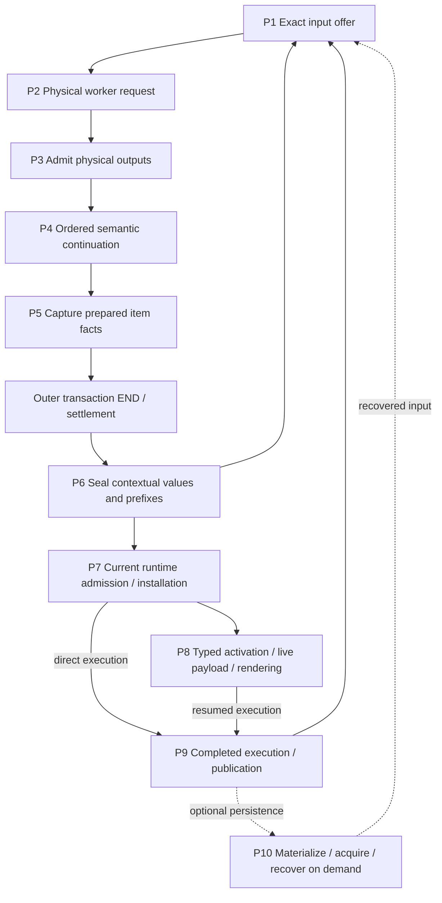

# Compiler work and authority map

Production workflow map checked at `8245fa800aec17fd7fd37fbe64cd4a35aa3efcde`;
campaign qualification observations below use base
`5b74c2f1fe010c5c343e0c6f331d54328fbd5090` and their named joined revision.
The later source changes below were inspected at campaign `c10837d44d`;
qualification records their actual consumers separately from the demand-service
amendment. Proposed world/resolver owners are not existing production facts.
Stage names identify ownership boundaries; their timings are not additive.
Use [compiler profiling](compiler-profiling.md) for measurement and
[property testing](property-testing.md) for independent checks.

P3–P5 execute inside the outer compiler transaction. A worker response is not
outer END. `compile_cell_program_admitted_inner` wraps preparation in
`settle_compiler_transaction_cancellable`; `finish_cell_program_admitted`
checks the matching settled origin, Clean/NotStarted closure and host stop
observer before sealing P6. Retired or Unconfirmed closure cannot publish.

## Facts carried between owners

| Fact | Owner and boundary | Does not grant |
| --- | --- | --- |
| Immutable exact graph | `ScopeProofV3`, `ExactSelectionSnapshot`; scoped nodes and authenticated outgoing edges | Payload ownership, compiler namespace membership or executable demand |
| Physical custody | `ArtifactView` leases/acquisitions, request files, `ProgramNativeOutput`, acquired recovery inputs | Roles or native permission merely because bytes remain alive |
| Compiler selection | `CertifiedSourceSelection`, `CompilerInputProjection`; exact canonical/original binding per selected module | All historical originals in retained custody as alternatives |
| Native availability | `IssuedNativeOffer`, `RequestNativeAvailability`; Full/subset/explicit-empty and canonical affinity | Executable roots, lexical visibility or original-instance authority; partial unions cannot mint Full |
| Executable demand | Bound target inputs and scoped `NativeGroupBinding` closure | Whole-catalog selection; a group's issuer scope need not equal its carrier scope |
| Runtime state | Checked reservations, source leases, installed images, parked continuations/live values | Completion or a live value from compiler/type evidence alone |

A view's retained node projection is transitively closed under immutable scoped
edges. Broader payload custody and proof-only ancestors are not extra members.
A canonical-only projection can retain group custody without selecting code;
`select_roots(OriginalId)` can add available Group roots. Empty native permission
and absent decisions remain distinct.

Before native input reception, `RequestNativeAvailability::for_compiler_roles`
in [`declaration_context.rs`](../tidepool/toolchain/src/declaration_context.rs)
filters optional direct roots by the effective interface and any explicit
Original selection. It then retains exact transitive dependencies of surviving
roots. An excluded historical body can remain as a required dependency; native
input reception still checks its namespace against the selected roles and
refuses a conflicting explicit Original. Filtering availability does not remove
historical byte custody or select executable groups.

Dependency consumption and Full qualification are separate decisions. Native
binding consults the effective compiler role from its request owner, both when
acquiring catalogue dependencies and when admitting a certified target. A
canonical-only role can consume an already-issued historical closure with
the same canonical `ArtifactId` while preserving its exact group/carrier edges. It
cannot mint Full availability, substitute an explicit Original selection, or
resolve competing group candidates by payload equality. Looking only at the
parent namespace misses incoming Original roles. Unfinished product dependency
proofs do not qualify for this historical-offer path.

The first repair (`ee0dc086`) passed its component control but the real retained
command failed at the later certified-target consumer. `27511a55` unifies that
role observation and extends the control through a real prepared request,
certified selection and bound target. Its joined execution is pending. This is
why catalogue-only evidence cannot establish the whole continuation contract.

## P1–P10: producer, consumer and remaining work

Paths below name the owning modules; symbols are searchable anchors.

| Stage | Current producer → result → consumer | Work and guards that remain |
| --- | --- | --- |
| **P1 Input offer** | [`artifacts.rs`](../tidepool/toolchain/src/artifacts.rs) `select_cell_program_with_catalog` / `checked_value_context` → exact offer; [`declaration_context.rs`](../tidepool/toolchain/src/declaration_context.rs) `extend_retained_value_artifacts` composes retained support → updated context → candidate/private-input selection → `ExactCompileContext::prepare_compilation_with_private_input` | Retained-value loop, support merges and lexical/template composition. Request construction closes support, projects metadata and receives native inputs with role coverage, Full qualification and consumed-namespace checks before physical lowering. One main value support owner replaces the old parallel broad artifact owner; carried roles avoid repeated resolution, not receiving validation. |
| **P2 Physical request** | [`turn.rs`](../tidepool/runtime/src/session/turn.rs) preparation → bound endpoint `execute_with_input_files` → worker response and original physical observation | Current source/evidence, concrete input files/manifest, compiler epoch and response framing; owners survive outer settlement. Accepted indeterminate requests cannot replay. Semantic continuation no longer lowers another physical request per item. |
| **P3 Output admission** | [`artifacts.rs`](../tidepool/toolchain/src/artifacts.rs) `prepare_cell_program_outputs`, `read_program_output`; [`certified_products.rs`](../tidepool/toolchain/src/certified_products.rs) `CertifiedSegmentOriginals::issue` → checked receipt, typed target, certified segment | Named output existence/access/size, source/producer/receipt/package/native checks. Runtime output reader and ordinary invocation-layout reader remain distinct frontdoors. Segment certification issues completed availability once for its consumer. |
| **P4 Ordered continuation** | [`declaration_context.rs`](../tidepool/toolchain/src/declaration_context.rs) `ProgramAdmissionContinuation`, `admit_program_support_inner`; planned declaration certifier → updated exact support/lexical/value context | Each item adds genuinely new facts and preserves its prefix, original segment baseline, source adjacency, produced-type exclusions and private native choices. Fresh value-interface append avoids full admission/dependency reconstruction, but still carries persistent rows/parent owners. Planned declarations borrow issued original inputs; redundant baseline reopen/merge and unused generic fingerprint parse are gone. Dummy `__result` compilation remains. |
| **P5 Prepared capture** | [`artifacts.rs`](../tidepool/toolchain/src/artifacts.rs) `capture_prepared_items`; [`checked_cell.rs`](../tidepool/toolchain/src/checked_cell.rs) `PreparedCheckedItemOutput::capture` → `PreparedCellProgram` | Before END: exact checked-cell/item/source/purpose/generation association, binders/sites/typed entry, target demand and entry requirements. Target and entry closures differ. Source-publication selection still validates all applicable rows; no narrow-query bypass of malformed unused evidence. This is not yet a sealed contextual value. |
| **P6 Contextual seal** | [`artifacts.rs`](../tidepool/toolchain/src/artifacts.rs) `PreparedCellProgram::seal` → lazy `PreparedValueSourceSupport` at the first native item; [`checked_cell.rs`](../tidepool/toolchain/src/checked_cell.rs) `CheckedItemOffer::seal_prepared` / value `capture_output` → exact item, checked values and ordered prefix | Declaration-only sealing constructs no value support; a mixed cell constructs one at its first native item. That source property still needs an enabled actual seal 0/1 span observation. After END: host cancellation, same-cell owner/order, per-output original execution, source/type/template support and immutable output ownership. Broad duplicate value artifact custody is removed; template and original execution facts still differ across outputs. Pending segment candidate publication follows item seals, with cancellation checks. |
| **P7 Admit/install** | [`turn.rs`](../tidepool/runtime/src/session/turn.rs), [`admission.rs`](../tidepool/runtime/src/session/admission.rs) `RuntimeCheckedPrefix`, [`resident.rs`](../tidepool/runtime/src/session/resident.rs) `install_certified_turn_in` → admitted current turn, installed target/dependency images and source leases | Current scope/reservations/generations/imports, complete image/table/constructor metadata, source-scope recheck, atomic root registration/rollback. Reusable compiled plans do not reserve future runtime state. |
| **P8 Activate/render** | Original provenance/site witnesses → demand-specific InterfaceOnly type projection; [`resident.rs`](../tidepool/runtime/src/session/resident.rs) `RuntimeActivationInput` binds parked frame/runtime scope → live payload; original execution → display dictionaries | Empty input demand still validates target/table/sites/bundle and producer. Type evidence, live payload and captured original instance environment are separate. Eager whole original-interface materialization is removed from no-demand sealing; actual witnessed type demand projects through its owner. |
| **P9 Publish** | [`paired_publication.rs`](../tidepool/runtime/src/session/paired_publication.rs) `FinalExecutionIntent` + exact current views/leases → staged durable publication and installation acknowledgement | Semantic interference requires recertification; metadata-only changes may restage. Do not rerun effects to reconstruct completed intent. Compiler candidate publication in P6 is not this runtime/store commit. |
| **P10 Persist/recover** | [`exact_context.rs`](../tidepool/toolchain/src/exact_context.rs) `Materializer::materialize_context` / `hydrate_context` plus acquired certified inputs → restored exact context | Conditional on persistence/recovery demand, not every cell. v5 full proof scopes include ancestors required by saved offers even when graph projection omits sibling payloads. Validate unused proofs, expected root/toolchain, roles/availability/decisions and physical acquisition; no live source-instance completion authority is restored from bytes. |

The request also owns the metadata used to certify its compiler selection:
`CertifiedSourceSelection::from_compiler_inputs` derives it from
`RequestCompilerInputs`. Callers cannot supply a second metadata owner. This
transfers roles and issued availability; it does not itself select executable
groups. `ArtifactView::retained_source_implementations` is a retained-implementation
census for lexical traversal, not the compiler role map or an execution grant.

## Admission-tail join: four implemented changes

These changes specialize existing issuers; they do not batch different permission
environments or construct a new graph/availability authority.

| Change / current owner | Deleted work | Preserved boundary and discriminating checks |
| --- | --- | --- |
| **Scoped parent membership** — `ArtifactInventory::issue_selected_custody` in [`artifact_inventory.rs`](../tidepool/toolchain/src/artifact_inventory.rs) | Per-chosen-input `admitted_closure` plus subset scan becomes exact parent-node membership | Prior original-role, ordinal and state-existence checks/refusal order remain; later `required_nodes` union remains. Independent proof-row fixed point covers ordinary/preseeded views, merge, hidden custody, writer/hydration/recovery, equal payload/different scope and proof-only siblings. |
| **Shared immutable validation facts** — `validate_available_originals_with_validation`, `OriginalValidationInventory` in [`certified_products.rs`](../tidepool/toolchain/src/certified_products.rs) | Repeated available-owner census and authenticated group lookup across availability roots | Facts may be shared; each root's advertised/private permission predicate and import validation remain separate. First-root sorted refusal order is preserved. A cached fact from an earlier private root cannot grant a later unqualified root permission. |
| **Carried verified closure** — `bind_input_demand`, `VerifiedNativeBinding`, `bind_fresh_product_dependencies` in [`native_availability.rs`](../tidepool/toolchain/src/artifact_inventory/native_availability.rs) | Immediate repeated installed closure walks for already checked bindings | Private binding+closure is minted only after installed-closure equality; consumed within that acquisition. Declared namespace checks, exact group/carrier identity, later root attribution and payload lifetime remain. |
| **Carried admitted entries** — `CertifiedSourceSelection::complete_native_entries`, `CompletedRequestNativeProducts`, `issue_complete_native_availability_with_source` | Request completion no longer reconstructs `ArtifactEntry::original_with_validation` from its already admitted product | Carry actual `Arc<ArtifactEntry>` including acquisition owner; producer/source/canonical/completeness and solver permission checks remain. Candidate input still uses physical construction/validation. Interner pointer equality alone would not prove construction was skipped. |

## Reading timers without double counting

`InvocationTiming` is opt-in under `exomonad_harness::timing`: monotonic wall and
current-thread CPU, sequence/phase, success/early-exit/panic. Preserve enclosing
cell/request span ancestry and classify by nearest **offer / admit / seal**;
constructors occur under all three. Sequential phases within one invocation can
be compared; nested sequences are inclusive. Report interval unions and unknown
parent-local residual, not sums of parents and children. `finish` can precede
local destruction; residual may include intermediate-view/cache drops and
tracing emission as well as uninstrumented algorithm work.

| Sequence | Current sub-boundaries |
| --- | --- |
| `products.cell_program.select_offer` / retained-value extension | Retained projections/interfaces argument preparation, checked value context, candidate selection, private availability, exact input; per-value support/template composition. Apply/staging and diagnostics are separate outer siblings. |
| `exact.compiler_support.new`, `.merge`, `exact.compiler_input_merge` | Projection validation, association/role/native resolution, issued merge validation, namespace/root/custody selection, selection/materialization retention and normalized/canonical availability. Inner phases remain nested under their caller. |
| `products.segment_originals` | Certification, package availability, source membership, artifact/value entries, segment availability and final segment assembly. |
| `products.segment_native_availability` | Interface admission, continuation, metadata projection plus completed-availability receipt, finishing new products. |
| `products.native_selection` | Projection/continuation rows, input offer custody, complete-entry selection and issuance, coverage, complete offer custody and final preservation. |
| `products.complete_native_availability` | Projection, entries, requirements **and** dependency catalog, namespace admission, complete issuance, body validation, offer retention and normalization. |
| Prepared item / seal / capture | P5 receipt/entry/target/source facts; P6 output/surface/template capture and retention, final support construction/merge/validation. Successful `Ok(None)` is distinct from failed capture. |

The admission-tail timers add clocks and phase labels around existing synchronous
work; they add no work counters or graph census. Separate owning counters are
needed to establish how many
chosen inputs, unique groups, immutable facts or permission environments exist.

## Evidence and qualification boundary

The shared warm compiler campaign starts from the imported peer repair at
`70a92c65a02a591f76590daf4e5bfa3e6fcbf723`, followed by the planning commit
above. This is a source prerequisite, not a newly qualified compiler rewrite.
The stronger shared-workspace Persona regression executed once at exact `70a`:
one selected/executed case passed, exit 0, direct compiler, minimal trace.
Process and hosted cleanup were confirmed; compiler cleanup was `not_observed`
with its observation complete, and diagnostic evidence was incomplete. The
[retained case report](/srv/swarm/evidence/inanna/admission-analysis-review-20261018/overnight-70a-strong-persona/host-cases/e27eec134184eea75959071896799d075b55b040628a49a0e25165b9be2fab4e.json)
therefore establishes focused behavior, not frozen timing or compiler cleanup.
Its shared workspace Gitlink is `ce60f76888c94e9d7229615f27762d02933549b1`;
the live failure's `457d7d` workspace is a distinct source identity.

The [campaign acceptance matrix](../plans/shared-warm-compiler/qualification/ACCEPTANCE.md)
tracks exact joined folds separately from semantic, work-counter, performance,
frozen-release and deployment claims. A reference hit alone cannot establish
eliminated physical input work: `ExactCompilationRequest::input_transport_files`
and its export consumers must also avoid baseline part/FD enumeration. Work
moved into root publication or commit remains part of the same workflow.

The qualification-only join `64636e485a901a289b2edf8d85abcc919538f581`
seals the stronger shared-root case into the next frozen `persona-startup` roster
and repairs reuse reporting for invalid physical requests. Aggregate and cycle
reuse counts become unknown on missing/duplicate/failed physical boundaries;
raw events remain available, and a valid completed earlier cycle remains visible
when a later cycle is incomplete. Workload promotion requires the exact request's
observed status as well as exit 0. Both declared script targets executed at that
clean join: 89 reporter/profile cases and 436 qualification/report cases passed.
These controls establish observer sensitivity and roster selection. Current
native compiler/host execution, work elimination, paired performance and frozen
release qualification remain pending.

The immutable current baseline is exact `6d3b1745b465b6d0fe14104cb4020ead282f1620`,
`fast-dev`, workspace `ce60f7`, Harness `1893773e`; it is built, frozen and verified.
Descriptor SHA-256 `2ec9745698f1a578403e7524397d3fe573d97efdb8cb489457f3ca007775e72e`.
Its minimal-profile AABA and Persona13 each passed one counted case and exact
owner-issued workload/frozen timing claims. AABA body wall was 86.094 s:
38.326 s activation, 14.121/9.983/11.499/11.619 s cells, 0.532 s shutdown,
5.866 ms installation verification and 7.687 ms unpartitioned remainder.
Each cell issued two exact matched physical requests; source repetition alone
establishes neither a worker-world hit nor removed work. Persona13 cohort wall
was 387.000 s with all 13 phases. Process, hosted and compiler cleanup confirmed
for both; diagnostic evidence was complete only for AABA. Minimal tracing leaves
host preparation and serialize/hydrate/GHC/output-admission splits unknown;
a full-profile AABA attribution capture is separate. These are baseline
observations, not a candidate comparison or a speedup.

The same frozen baseline's stronger shared-root Persona failed in editable
workspace setup after resident daemon start and zero compiler requests: a readonly
frozen lock was copied with its mode and then overwritten. The original bundle
remains immutable. Reviewed fixture repair `38c53f8b`, area source `e6d713626d`,
uses the existing durable atomic writer into a fresh writable inode. Production,
cfg(test), declared resources and two counted scaffold/recovery controls passed;
its newly frozen bundle verified.

That new frozen stronger Persona reached startup and Files/Memory, then failed
all five native lookup answers before physical submission. Effective selected
catalog `Jev.Tidepool` B differs from exact required historical A. Real retained
`Jev.Operators` group edges consume A; matching source/product/interface bytes
cannot substitute certification or bindings. All cleanup domains were confirmed
and diagnostics complete. The exact current root operands and first contradictory
composition stage remain unobserved; production roles before/after value support,
authored fallback and catalog/private composition are the discriminating next
observation. The strict consumed-native validator remains correct. See the
[exact frozen report](/srv/swarm/evidence/inanna/shared-warm-qualification-20261019/fixture-repair-e6d/run-shared-persona/report.json)
and [issuer review](/srv/swarm/evidence/inanna/shared-warm-qualification-20261019/baseline-oracle-review/FROZEN-NATIVE-LOOKUP-REVIEW.md).
This is a failed semantic gate, separate from the valid fixture repair.

## Later joined source and remaining physical work

At inspected campaign `c10837d44d`, selected compiler roles use persistent
`imbl::OrdMap` rows and shared home-unit storage. `PreparedValueSourceSupport`
borrows selected rows from its exact context, avoiding a full metadata-snapshot
copy; lexical import composition and retained-source implementation census remain.
Its ordinary debug span `exact.value_source_support.prepare` measures actual
constructor calls only when enabled. Synthetic issuer controls do not observe
real P6 constructor counts.

Owned checked inputs avoid writing/rehashing the certified baseline on the
same-owner route, and owned output rows preserve immutable acquisition owners.
`CheckedInputWork` counts initial files/bytes and output hashes, not every compiler
read or publication copy. `RetainedArtifactMaterialization::selected_rows` still
visits retained owners/rows and selected metadata. `input_transport_files` still
walks selected slices, graph paths and metadata to collect physical leases;
`original_inputs::encode_image` still encodes selected parts. No eliminated full
FD enumeration, serialization or rehydration is established.

Rust source-free `EnsureExactInputs` framing and END guards exist; inspected
Haskell production `Main.hs` returns `ExactInputsRejected UnsupportedOperation`.
The request decoder memo/prune policy and atomic publication controls have native
component evidence, but this is not a production Ready hit or persistent world.
The demand-service amendment requires the actual frontend public-module query,
current world/provenance, exact proof reuse without an unnecessary target, and
query/check/execute distinctions. A retained exact type proof can legitimately
answer without invoking the compiler. Changed bindings require a private exact
successor and atomic Rust visibility after clean outer END. Cold restore must
retain source-domain facts without replay; repeated unchanged facts must avoid
full host maps/support/exports, FD enumeration, encoding and full worker hydration.
Fixed changed dependency/output counts must remain flat as unrelated history
grows; genuinely demanded dependency growth remains valid. These are open
qualification obligations; missing measurements are unknown.

Full AABA attribution is separate from minimal timing. The four main request
service times were 10.077/7.236/8.733/9.269 s, plus tiny check requests of
8/6/7/8 ms. Inclusive host execute/admit/offer/seal totals were
38.590/6.080/1.354/0.287 s. Nested worker segment frontend was 15.272 s,
GHC setup 10.906 s, load 0.573 s, explicit typecheck 0.698 s,
prepared recovery 0.551 s and encoding 0.006 s. These totals overlap;
physical service is not GHC-only. Each main target decoded 82 exact-scope
certificates. Absent transfer stages leave full map/FD/serialize/hydrate counts
unknown. Raw full trace is complete but bounded runner detail is truncated;
no paired speedup follows.

Historical **b108** scripted Persona13 measurements include 389 retained input
references across 13 offers (not 389 distinct graphs), 64 native-item
continuations (~61.283 s inclusive) and 64 value captures (~34.438 s inclusive).
The b108 stage table separately reports `certify_segment_original_products`
**20.003934 s** (13 calls). The later entry-carry planning report quotes a
segment-tail **18.219 s** and **12.013 s** issuance component, but the direct
source-bound aggregate/trace establishing those two figures has not been
recovered for this map. Treat them as previously reported **whole 13-cell cohort
planning figures needing baseline confirmation**, not established b108 measured
components, per-cell costs or predicted savings. Parent/child totals overlap.
Current source has the implementations above; historical observations cannot
establish their benefit.

The observer baseline `20d7ccdcf6ed13a5e0db7ffa89527224a95606ec` compiled and its
single timing control executed PASS. Its exact frozen packaged workload also
passed: one selected/executed case, all 13 ordered phases, **404.511 s** whole-case
wall time. The workload uses a scripted provider and generic prepared/custom
history, not the authored Persona spec. The descriptor SHA-256 is
`48dc946cd245445b890aa95b64372c6ce41641f19a19e11a75887a8953c2515d`;
the [terminal receipt](/srv/swarm/evidence/inanna/admission-analysis-review-20261018/overnight-20d7-baseline/BASELINE13-TERMINAL.json)
links the counted report, phase coverage and timing evidence.
The four-parcel join `233f988d` and later release checkpoint `8245fa800a` have
source review. The latter adds the correctness repairs described above; its
joined native qualification and matched timing remain pending. This baseline result does not measure the four
changes' savings.
Compilation, test execution, source acceptance and a measured workload are
separate claims. This map introduces no new release gate or performance claim.

Retained private evidence on swarm-01 (the source documents remain useful even
when their then-pending qualification status has since advanced):

- [v1 workflow and invariants](/srv/swarm/evidence/inanna/overnight-release-20261018/compiler-work-invariant-atlas-review-final-v1/WORK-MAP.md), [invariant matrix](/srv/swarm/evidence/inanna/overnight-release-20261018/compiler-work-invariant-atlas-review-final-v1/INVARIANTS.md).
- [b108 preparation mapping](/srv/swarm/evidence/inanna/overnight-release-20261018/compiler-work-invariant-atlas-joined-v2-preparation/WORK-MAP.md), [actual stage table](/srv/swarm/evidence/inanna/overnight-release-20261018/compiler-work-invariant-atlas-joined-v2-b108-actual/STAGE-TABLE.md).
- [Entry-carry planning report (18.219/12.013 provenance limit above)](/srv/swarm/evidence/inanna/overnight-release-20261018/postcompiler-entry-carry-proposal.md).
- [Admission-tail timer review](/srv/swarm/evidence/inanna/overnight-release-20261018/admission-tail-instrumentation-review.md), [four-parcel source review](/srv/swarm/evidence/inanna/overnight-release-20261018/boundary-contract-coverage/admission-tail-review-20261019.json).

## Required actor client migration: callsite dispositions

The accepted Rust-client migration requires ordinary cells, successors and recovery,
not only a faster query. This inventory is inspected at exact `278cd12c95` (the
owning production trees match `f088e3e783`). It establishes open migration work;
none of these rows claims the proposed service client is implemented.

| Consumer | Existing production owner / reconstruction | Required final disposition and evidence |
| --- | --- | --- |
| Native and notebook lookup | Actor `resident_workbench::actor_compile_view` / `inspect_actor_batch`; runtime `capture_inspection_inputs`; toolchain `ModuleCandidateOffer::select_inspection_for_with_catalog` extends all retained checked values | Migrate compiler questions through the published-session client. Located exact type proofs may answer without a worker call; retain current logical world and provenance. Exact frozen catalog-backed conflict remains a separate required regression. |
| Ordinary cells | Runtime `session::admission` captures value interfaces for admission; `session::turn::compile_cell_program_admitted_inner`; toolchain `select_cell_program` builds checked-value context | Migrate preparation through actual authored changes and required references. Measure fixed appended-cell and publication work as unrelated history grows; no cache-initializer or commit-time full reconstruction. |
| Declaration-only preparation | Same ordered program path, with zero native items and lazy P6 support | Migrate the compiler preparation demand; retain ordered visibility and observed zero native-support construction when enabled. Do not add a mandatory separate expression pre-check. |
| Renderer specialization | Actor activation-preview preparation; captured original type/instance environment; runtime original execution and dictionary admission | Classify compiler specialization through the common client separately from intentionally distinct runtime certificate, native and machine admission. Removing those authority checks is not migration. |
| Startup | Actor/source bootstrap and ordinary checked program preparation | Use one published source/profile/binding owner; verify real scaffolded shared-source Persona and exact native dependencies. No historical direct-run substitution for frozen evidence. |
| Fork and reload | Existing session/publication and generation fence owners; source-context capture | Publish coherent world/bindings per branch or generation after clean END; preserve independent actor worlds and explicit partial/uncertain outcomes. Classify every surviving old compiler front. |
| Recovery and eviction | Existing durable exact-context materializer/acquisition and session restoration | Version/refuse obsolete authority explicitly; restore the same logical world and captured source absence without live rereads or source/effect replay. Encoding components may remain only with a justified distinct producer. |

Final dispositions must be source-backed: **migrated**, **intentionally distinct
runtime consumer**, **explicitly unsupported profile**, or **obsolete/deleted**.
Supported unclassified reconstruction routes remain blockers. Cold first capture
may visit the primary snapshot once; historical binding support stays separate from
current compiler selection. The fixed query and appended-cell measurements include
successor and durable publication work. Query-only success is partial delivery.

The bounded qualification repair separates `CandidateSet.contextual_native_availability`
from explicitly selected compiler outputs. `OriginalCompilerInputs::from_candidates`
authenticates and carries custody under receiving roles; it does not select every
available catalog body as a new Original. Actual selected outputs retain the
`CertifiedSourceSelection` / `from_selection` issuer and exact historical dependencies.
This source observation is specific to the qualification foundation: actual compiled
Request permission refusal/Full positive and full source-proof pairing have executed;
retained-generation, scoped-issuer, physical lifetime and independent generated histories
have source-specific passing receipts in the qualification handoff. Foundation `943aafec`
removes the alternate Candidate issuers and obsolete callers; its final owning targets
compiled and its complete history received independent source review. Campaign receiving
compilation remains a separate gate.
A separate strict publication-context failure remains: saved root reconstruction reattaches
later unrelated offers as logical custody. The Context6 birth-owner implementation is a
qualification WIP, excluded from that foundation. Its exact offer-mode, acquisition lifetime,
writer/reader/consumer and hot-publication work gates remain open; no map entry claims
that owner is qualified.
The actual frozen428b path remains a
required rerun after integration. No full-map, FD, encoding or hydration work reduction
is inferred from this role correction; the service and actor migration rows above
remain open until their actual consumers and counters execute.
