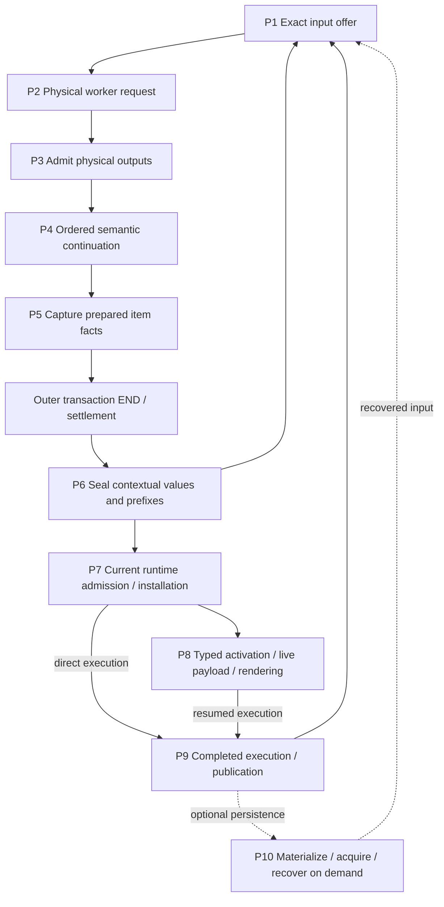

# Compiler work and authority map

Source checked at `8245fa800aec17fd7fd37fbe64cd4a35aa3efcde` (reviewed release checkpoint).
This is the current production workflow, not a list of proposed optimizations.
Stage names identify ownership boundaries; their timings are not additive.
Use [compiler profiling](compiler-profiling.md) for measurement and
[property testing](property-testing.md) for independent checks.

P3–P5 execute inside the outer compiler transaction. A worker response is not
outer END. `compile_cell_program_admitted_inner` wraps preparation in
`settle_compiler_transaction_cancellable`; `finish_cell_program_admitted`
checks the matching settled origin, Clean/NotStarted closure and host stop
observer before sealing P6. Retired or Unconfirmed closure cannot publish.

## Facts carried between owners

| Fact | Owner and boundary | Does not grant |
| --- | --- | --- |
| Immutable exact graph | `ScopeProofV3`, `ExactSelectionSnapshot`; scoped nodes and authenticated outgoing edges | Payload ownership, compiler namespace membership or executable demand |
| Physical custody | `ArtifactView` leases/acquisitions, request files, `ProgramNativeOutput`, acquired recovery inputs | Roles or native permission merely because bytes remain alive |
| Compiler selection | `CertifiedSourceSelection`, `CompilerInputProjection`; exact canonical/original binding per selected module | All historical originals in retained custody as alternatives |
| Native availability | `IssuedNativeOffer`, `RequestNativeAvailability`; Full/subset/explicit-empty and canonical affinity | Executable roots, lexical visibility or original-instance authority; partial unions cannot mint Full |
| Executable demand | Bound target inputs and scoped `NativeGroupBinding` closure | Whole-catalog selection; a group's issuer scope need not equal its carrier scope |
| Runtime state | Checked reservations, source leases, installed images, parked continuations/live values | Completion or a live value from compiler/type evidence alone |

A view's retained node projection is transitively closed under immutable scoped
edges. Broader payload custody and proof-only ancestors are not extra members.
A canonical-only projection can retain group custody without selecting code;
`select_roots(OriginalId)` can add available Group roots. Empty native permission
and absent decisions remain distinct.

Dependency consumption and Full qualification are separate decisions. Native
binding consults the effective compiler role from its request owner, both when
acquiring catalogue dependencies and when admitting a certified target. A
canonical-only role can consume an already-issued historical closure with
the same canonical `ArtifactId` while preserving its exact group/carrier edges. It
cannot mint Full availability, substitute an explicit Original selection, or
resolve competing group candidates by payload equality. Looking only at the
parent namespace misses incoming Original roles. Unfinished product dependency
proofs do not qualify for this historical-offer path.

The first repair (`ee0dc086`) passed its component control but the real retained
command failed at the later certified-target consumer. `27511a55` unifies that
role observation and extends the control through a real prepared request,
certified selection and bound target. Its joined execution is pending. This is
why catalogue-only evidence cannot establish the whole continuation contract.

## P1–P10: producer, consumer and remaining work

Paths below name the owning modules; symbols are searchable anchors.

| Stage | Current producer → result → consumer | Work and guards that remain |
| --- | --- | --- |
| **P1 Input offer** | [`artifacts.rs`](../tidepool/toolchain/src/artifacts.rs) `select_cell_program_with_catalog` / `checked_value_context` → exact offer; [`declaration_context.rs`](../tidepool/toolchain/src/declaration_context.rs) `extend_retained_value_artifacts` composes retained support → updated context → candidate/private-input selection → `ExactCompileContext::prepare_compilation_with_private_input` | Retained-value loop, support merges and lexical/template composition. Request construction closes support, projects metadata and receives native inputs with role coverage, Full qualification and consumed-namespace checks before physical lowering. One main value support owner replaces the old parallel broad artifact owner; carried roles avoid repeated resolution, not receiving validation. |
| **P2 Physical request** | [`turn.rs`](../tidepool/runtime/src/session/turn.rs) preparation → bound endpoint `execute_with_input_files` → worker response and original physical observation | Current source/evidence, concrete input files/manifest, compiler epoch and response framing; owners survive outer settlement. Accepted indeterminate requests cannot replay. Semantic continuation no longer lowers another physical request per item. |
| **P3 Output admission** | [`artifacts.rs`](../tidepool/toolchain/src/artifacts.rs) `prepare_cell_program_outputs`, `read_program_output`; [`certified_products.rs`](../tidepool/toolchain/src/certified_products.rs) `CertifiedSegmentOriginals::issue` → checked receipt, typed target, certified segment | Named output existence/access/size, source/producer/receipt/package/native checks. Runtime output reader and ordinary invocation-layout reader remain distinct frontdoors. Segment certification issues completed availability once for its consumer. |
| **P4 Ordered continuation** | [`declaration_context.rs`](../tidepool/toolchain/src/declaration_context.rs) `ProgramAdmissionContinuation`, `admit_program_support_inner`; planned declaration certifier → updated exact support/lexical/value context | Each item adds genuinely new facts and preserves its prefix, original segment baseline, source adjacency, produced-type exclusions and private native choices. Fresh value-interface append avoids full admission/dependency reconstruction, but still carries persistent rows/parent owners. Planned declarations borrow issued original inputs; redundant baseline reopen/merge and unused generic fingerprint parse are gone. Dummy `__result` compilation remains. |
| **P5 Prepared capture** | [`artifacts.rs`](../tidepool/toolchain/src/artifacts.rs) `capture_prepared_items`; [`checked_cell.rs`](../tidepool/toolchain/src/checked_cell.rs) `PreparedCheckedItemOutput::capture` → `PreparedCellProgram` | Before END: exact checked-cell/item/source/purpose/generation association, binders/sites/typed entry, target demand and entry requirements. Target and entry closures differ. Source-publication selection still validates all applicable rows; no narrow-query bypass of malformed unused evidence. This is not yet a sealed contextual value. |
| **P6 Contextual seal** | [`artifacts.rs`](../tidepool/toolchain/src/artifacts.rs) `PreparedCellProgram::seal` → one `PreparedValueSourceSupport`; [`checked_cell.rs`](../tidepool/toolchain/src/checked_cell.rs) `CheckedItemOffer::seal_prepared` / value `capture_output` → exact item, checked values and ordered prefix | After END: host cancellation, same-cell owner/order, per-output original execution, source/type/template support and immutable output ownership. Broad duplicate value artifact custody is removed; template and original execution facts still differ across outputs. Pending segment candidate publication follows item seals, with cancellation checks. |
| **P7 Admit/install** | [`turn.rs`](../tidepool/runtime/src/session/turn.rs), [`admission.rs`](../tidepool/runtime/src/session/admission.rs) `RuntimeCheckedPrefix`, [`resident.rs`](../tidepool/runtime/src/session/resident.rs) `install_certified_turn_in` → admitted current turn, installed target/dependency images and source leases | Current scope/reservations/generations/imports, complete image/table/constructor metadata, source-scope recheck, atomic root registration/rollback. Reusable compiled plans do not reserve future runtime state. |
| **P8 Activate/render** | Original provenance/site witnesses → demand-specific InterfaceOnly type projection; [`resident.rs`](../tidepool/runtime/src/session/resident.rs) `RuntimeActivationInput` binds parked frame/runtime scope → live payload; original execution → display dictionaries | Empty input demand still validates target/table/sites/bundle and producer. Type evidence, live payload and captured original instance environment are separate. Eager whole original-interface materialization is removed from no-demand sealing; actual witnessed type demand projects through its owner. |
| **P9 Publish** | [`paired_publication.rs`](../tidepool/runtime/src/session/paired_publication.rs) `FinalExecutionIntent` + exact current views/leases → staged durable publication and installation acknowledgement | Semantic interference requires recertification; metadata-only changes may restage. Do not rerun effects to reconstruct completed intent. Compiler candidate publication in P6 is not this runtime/store commit. |
| **P10 Persist/recover** | [`exact_context.rs`](../tidepool/toolchain/src/exact_context.rs) `Materializer::materialize_context` / `hydrate_context` plus acquired certified inputs → restored exact context | Conditional on persistence/recovery demand, not every cell. v5 full proof scopes include ancestors required by saved offers even when graph projection omits sibling payloads. Validate unused proofs, expected root/toolchain, roles/availability/decisions and physical acquisition; no live source-instance completion authority is restored from bytes. |

The request also owns the metadata used to certify its compiler selection:
`CertifiedSourceSelection::from_compiler_inputs` derives it from
`RequestCompilerInputs`. Callers cannot supply a second metadata owner. This
transfers roles and issued availability; it does not itself select executable
groups. `ArtifactView::retained_source_implementations` is a retained-implementation
census for lexical traversal, not the compiler role map or an execution grant.

## Admission-tail join: four implemented changes

These changes specialize existing issuers; they do not batch different permission
environments or construct a new graph/availability authority.

| Change / current owner | Deleted work | Preserved boundary and discriminating checks |
| --- | --- | --- |
| **Scoped parent membership** — `ArtifactInventory::issue_selected_custody` in [`artifact_inventory.rs`](../tidepool/toolchain/src/artifact_inventory.rs) | Per-chosen-input `admitted_closure` plus subset scan becomes exact parent-node membership | Prior original-role, ordinal and state-existence checks/refusal order remain; later `required_nodes` union remains. Independent proof-row fixed point covers ordinary/preseeded views, merge, hidden custody, writer/hydration/recovery, equal payload/different scope and proof-only siblings. |
| **Shared immutable validation facts** — `validate_available_originals_with_validation`, `OriginalValidationInventory` in [`certified_products.rs`](../tidepool/toolchain/src/certified_products.rs) | Repeated available-owner census and authenticated group lookup across availability roots | Facts may be shared; each root's advertised/private permission predicate and import validation remain separate. First-root sorted refusal order is preserved. A cached fact from an earlier private root cannot grant a later unqualified root permission. |
| **Carried verified closure** — `bind_input_demand`, `VerifiedNativeBinding`, `bind_fresh_product_dependencies` in [`native_availability.rs`](../tidepool/toolchain/src/artifact_inventory/native_availability.rs) | Immediate repeated installed closure walks for already checked bindings | Private binding+closure is minted only after installed-closure equality; consumed within that acquisition. Declared namespace checks, exact group/carrier identity, later root attribution and payload lifetime remain. |
| **Carried admitted entries** — `CertifiedSourceSelection::complete_native_entries`, `CompletedRequestNativeProducts`, `issue_complete_native_availability_with_source` | Request completion no longer reconstructs `ArtifactEntry::original_with_validation` from its already admitted product | Carry actual `Arc<ArtifactEntry>` including acquisition owner; producer/source/canonical/completeness and solver permission checks remain. Candidate input still uses physical construction/validation. Interner pointer equality alone would not prove construction was skipped. |

## Reading timers without double counting

`InvocationTiming` is opt-in under `exomonad_harness::timing`: monotonic wall and
current-thread CPU, sequence/phase, success/early-exit/panic. Preserve enclosing
cell/request span ancestry and classify by nearest **offer / admit / seal**;
constructors occur under all three. Sequential phases within one invocation can
be compared; nested sequences are inclusive. Report interval unions and unknown
parent-local residual, not sums of parents and children. `finish` can precede
local destruction; residual may include intermediate-view/cache drops and
tracing emission as well as uninstrumented algorithm work.

| Sequence | Current sub-boundaries |
| --- | --- |
| `products.cell_program.select_offer` / retained-value extension | Retained projections/interfaces argument preparation, checked value context, candidate selection, private availability, exact input; per-value support/template composition. Apply/staging and diagnostics are separate outer siblings. |
| `exact.compiler_support.new`, `.merge`, `exact.compiler_input_merge` | Projection validation, association/role/native resolution, issued merge validation, namespace/root/custody selection, selection/materialization retention and normalized/canonical availability. Inner phases remain nested under their caller. |
| `products.segment_originals` | Certification, package availability, source membership, artifact/value entries, segment availability and final segment assembly. |
| `products.segment_native_availability` | Interface admission, continuation, metadata projection plus completed-availability receipt, finishing new products. |
| `products.native_selection` | Projection/continuation rows, input offer custody, complete-entry selection and issuance, coverage, complete offer custody and final preservation. |
| `products.complete_native_availability` | Projection, entries, requirements **and** dependency catalog, namespace admission, complete issuance, body validation, offer retention and normalization. |
| Prepared item / seal / capture | P5 receipt/entry/target/source facts; P6 output/surface/template capture and retention, final support construction/merge/validation. Successful `Ok(None)` is distinct from failed capture. |

The admission-tail timers add clocks and phase labels around existing synchronous
work; they add no work counters or graph census. Separate owning counters are
needed to establish how many
chosen inputs, unique groups, immutable facts or permission environments exist.

## Evidence and qualification boundary

Historical **b108** scripted Persona13 measurements include 389 retained input
references across 13 offers (not 389 distinct graphs), 64 native-item
continuations (~61.283 s inclusive) and 64 value captures (~34.438 s inclusive).
The b108 stage table separately reports `certify_segment_original_products`
**20.003934 s** (13 calls). The later entry-carry planning report quotes a
segment-tail **18.219 s** and **12.013 s** issuance component, but the direct
source-bound aggregate/trace establishing those two figures has not been
recovered for this map. Treat them as previously reported **whole 13-cell cohort
planning figures needing baseline confirmation**, not established b108 measured
components, per-cell costs or predicted savings. Parent/child totals overlap.
Current source has the implementations above; historical observations cannot
establish their benefit.

The observer baseline `20d7ccdcf6ed13a5e0db7ffa89527224a95606ec` compiled and its
single timing control executed PASS. Its exact frozen packaged workload also
passed: one selected/executed case, all 13 ordered phases, **404.511 s** whole-case
wall time. The workload uses a scripted provider and generic prepared/custom
history, not the authored Persona spec. The descriptor SHA-256 is
`48dc946cd245445b890aa95b64372c6ce41641f19a19e11a75887a8953c2515d`;
the [terminal receipt](/srv/swarm/evidence/inanna/admission-analysis-review-20261018/overnight-20d7-baseline/BASELINE13-TERMINAL.json)
links the counted report, phase coverage and timing evidence.
The four-parcel join `233f988d` and later release checkpoint `8245fa800a` have
source review. The latter adds the correctness repairs described above; its
joined native qualification and matched timing remain pending. This baseline result does not measure the four
changes' savings.
Compilation, test execution, source acceptance and a measured workload are
separate claims. This map introduces no new release gate or performance claim.

Retained private evidence on swarm-01 (the source documents remain useful even
when their then-pending qualification status has since advanced):

- [v1 workflow and invariants](/srv/swarm/evidence/inanna/overnight-release-20261018/compiler-work-invariant-atlas-review-final-v1/WORK-MAP.md), [invariant matrix](/srv/swarm/evidence/inanna/overnight-release-20261018/compiler-work-invariant-atlas-review-final-v1/INVARIANTS.md).
- [b108 preparation mapping](/srv/swarm/evidence/inanna/overnight-release-20261018/compiler-work-invariant-atlas-joined-v2-preparation/WORK-MAP.md), [actual stage table](/srv/swarm/evidence/inanna/overnight-release-20261018/compiler-work-invariant-atlas-joined-v2-b108-actual/STAGE-TABLE.md).
- [Entry-carry planning report (18.219/12.013 provenance limit above)](/srv/swarm/evidence/inanna/overnight-release-20261018/postcompiler-entry-carry-proposal.md).
- [Admission-tail timer review](/srv/swarm/evidence/inanna/overnight-release-20261018/admission-tail-instrumentation-review.md), [four-parcel source review](/srv/swarm/evidence/inanna/overnight-release-20261018/boundary-contract-coverage/admission-tail-review-20261019.json).
