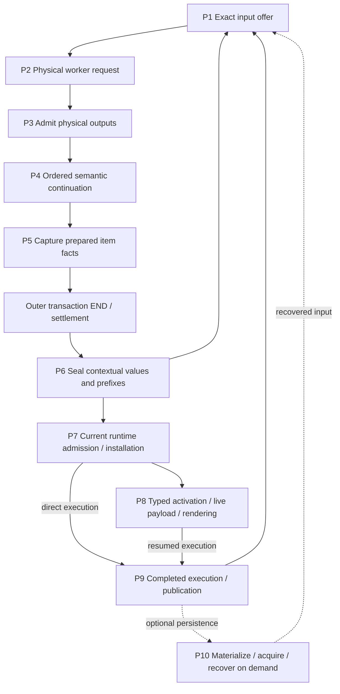

# Compiler work and authority map

The earlier integrated measurement baseline below is `f6d9976b70` (2026-10-20).
It contains the compiler-primary projection, bounded World residency, idle-worker
affinity, completed compiler-product handoff and the earlier affine retirement
tranche. Integration is not release qualification: the actual joined runtime
still exposes the failures listed below.
The later P1–P10 material describes the earlier finite path at
`8245fa800a`/`c10837d44d`; it is a historical deletion inventory, not the live
service dataflow. Stage timings are inclusive and are not additive. Use
[compiler profiling](compiler-profiling.md) for measurement and
[property testing](property-testing.md) for independent checks.

## Current package/runtime boundary review

Root integration `33b1ca3a52` contains the publication-owner and bootstrap repairs;
the compiler demand/package/runtime cutover is still receiving worker changes.
The [exact join contract](../plans/shared-warm-compiler/completion/package-runtime-join.md)
records the root review and required replacement dataflow. This is not a claim
that those changes have already passed joined execution.

Direct review of L's `f6c16ca648` intermediate found:

| Boundary | Actual remaining work | Replacement contract |
|---|---|---|
| `PreparedSourceEntry::prepare` → startup | Retains native images but drops the resolved import plan; startup runs `resolve_closed_source_entry_in` again. | Retain one closed occurrence-linked recipe; bind its exact links to a fresh installation without repeating selection. |
| `install_certified_turn` → package imports | Prefers machine-global `code_exports` over local definitions. | New isolated B gets fresh state; later cells reuse exact B-domain instances through scoped custody. |
| Native closure → runtime graph | Logical artifact/group and source-binder keys can collapse different exact historical dependency occurrences. | Preserve full issued binding/occurrence links independently of reusable code identity. |
| Package interface → product identity | Independently reading a path and hashing bytes can mismatch the decoded interface/body. | Decode and hash the same captured bytes; carry their provenance to the sole product issuer. |
| Actor test → source installation | Two probe helpers unwrap `entry.compiled().code()` and use ordinary startup. | Exercise the closed production installer; remove the public proof-erasing accessor after metadata consumers migrate. |

The old package CAF control uses two separate machines and does not establish
same-machine A/B isolation. Joined acceptance must also retire A and execute a
NEW B cell, preserve same-B instance reuse, and retain real captured-A refusal.
Immutable image sharing, fresh dispatch pointers and separate scope IDs are
useful component observations, not substitutes for that history. No post-cutover
performance result is available yet.

## Integrated service dataflow and remaining costs

The [demand-products contract](../plans/shared-warm-compiler/completion/demand-products.md)
owns the accepted implementation. The
[ownership completion contract](../plans/shared-warm-compiler/completion/ownership-completion.md)
owns the next repairs; the review checkpoint retains their failing baseline.

| Producer and consumer | Integrated boundary | Remaining work or qualification |
| --- | --- | --- |
| Rust `CompilerWorld` restoration → Haskell `ExactScope` | One private compiler-primary projection carries owner-checked compiler inputs. The full runtime Context commitment remains opaque to Haskell and distinct from compiler-input identity and native demand. | Rust still materializes and commits the runtime Context. This change removes over-delivery to the compiler, not all graph work. |
| Held World → staged native certification | The private issuer pairs its guarded completion with its actual pending predecessor and certified GHC Name associations. The existing worklist can acquire prior finalized source bodies without frontend replay. | SOURCE-cycle rehydration remains. Per-owner historical variant lookup and retained GHC heap remain real costs. Joined SOURCE history and Core controls pass; full actor acceptance is open. |
| `ExactInputOwner` → optional World residency | A shared 128 MiB default encoded-input allowance covers originals and World backing. World nodes no longer consume the separate 4096 original-image slots. Existing FIFO, backing ownership and cleanup quarantine remain. | The allowance is not a decoded-heap or filesystem-allocation bound. Per-World payload charging remains conservative. The 4097-file history passed on the receiving revision; actual joined startup is separate. |
| Endpoint binding → daemon scheduler | Best-effort affinity prefers a matching idle worker; busy/missing hints use the ordinary immediate fallback. Actual worker identity is observed after BEGIN. | Typed realization references and zero-reference direct Complete acquisition remain a separate receiving follow-up, with front-door controls still pending. No accepted query is replayed. |
| Public Reload → retirement owner | The earlier affine lifecycle tranche is integrated, including source slots and public callers. Later diagnostic/nonstart changes remain on the receiving lifecycle branch. | Real tests expose source-birth and fixture-boundary problems. Preparation permission under A must not be confused with an independent replacement B; genuine captured-A dependencies must remain. |

The triggering packet census measured 5,204 distinct reachable blocks: 4,698
HAMT nodes, two scope proofs and 504 smaller facts. The two proofs represented
20,951 logical native groups in different issuance scopes; they were not
duplicate nodes within one proof. The context subtree occupied about 54.3 MB,
while its separate primary-association subtree occupied about 45 KB. That is
evidence of over-delivery, not permission to erase distinct issuance scopes.

The retained trace measured three Complete acquisitions on the same process at
31.981 s, 33.149 s and 31.598 s. These are pre-change observations from the
investigation, not timings of this baseline or a forecast for the new design.
The first acquisition is not yet fully decomposed. The compiler projection
change also leaves Rust's runtime-context materialization and commitment
calculation as a measured residual, rather than claiming all graph work vanishes.

Canonical-interface diagnostics now identify the owner, expected/current seals and
selected certificate/input paths. The joined declared runtime cohort reproduces
`Tidepool.Aeson.FromJSON` mismatch before activation assertions. A pinned GHC
read/write of the retained expected interface is byte-identical; that excludes
only simple reserialization as a reproducer, not other compiler-state differences.
The actual differing current bytes were not retained by the earlier failure.
Source review found an independent provenance defect: selected canonical owners
can enter fresh frontend finalization, then pair with the earlier certificate in
a late owner-keyed join. Cross-case retained interfaces contain different physical
source paths inside executable error literals. Exact failure-pair capture and
co-issued reused/fresh acquisition products are in progress; neither is claimed
implemented by this baseline.

Reload review also found that effect-site provenance cannot certify whole-entry
independence, and a publication worker can lose its actual guard while retaining
only a terminal tag. The accepted replacement uses the existing closed
PreparedSourceEntry proof with a runtime-owned fresh install, and keeps the
publication guard in serial owner custody before dispatch. These are planned
repairs, not properties established by the current code.

Joined compilation passed for the production worker, Haskell source-boot test
binary, toolchain tests and actor tests. Two joined Haskell selections passed
(SOURCE history with eleven actual admissions; finalized Core). The actual
compiled-C test exposed a temporary validation namespace escaping as authored
Original selection; its private-result repair is integrated and the actual compiled-C history passes
(1 selected, 1 executed). The private completed result carries custody and offers,
not temporary selection roles or namespace. Do not weaken the role oracle or
rebuild exact issued dependency edges from a broader inventory.

## Earlier service checkpoint and receiving boundaries

The table below records root `24d8e0a9607d1a01377214d1a417ee6b324cb2f1`
and its then-receiving candidates. Its worker IDs and pending results are
historical context, not current integration or qualification evidence.

The controlling documents are the [completion plan](../plans/shared-warm-compiler/completion/plan.md)
and [implementation reset](../plans/shared-warm-compiler/completion/implementation-reset.md).
The [verification ledger](../plans/shared-warm-compiler/completion/tests/verification-ledger.md)
owns named discovery/notebook commands and their pending execution gates.
Persistent GHC processes already existed in the baseline. The intended change
removes repeated reconstruction and competing resident routes; process reuse
alone proves neither completion nor a speedup.

| Boundary | Root owner and carried facts | Receiving work and qualification limit |
| --- | --- | --- |
| Runtime admission | Runtime captures the actual original source, target scope, reservation and compiler World association. Source permission, checked execution provenance and compiler identity remain distinct. | engine_completion and root own the joined used/unused/wrong-payload and crossed/retired input controls. A compiler reply or an uncertain END cannot authorize evaluation or publication. |
| Held compiler environment | `HeldCompilerWorld` retains immutable input facts and `WorldPreparedModules`; `runHeldWorldSource` shares dependency preparation between closed cell and observation operations. Queries consume transient checked environments before returning. | H/engine owns phase-correct same-World environment and demanded prior-source-body restoration, including SOURCE cycles. R owns the Rust repeated-source-Original guard exposed by mixed reuse. Retained HPT entries alone do not establish a complete usable environment; no whole mutable `TcGblEnv` is retained as query authority. |
| Parsed operation and settlement | The shared source owner carries the actual parsed/no-quasiquote proof, native TYPE annotation and ordered stage facts. PREP5/protocol 27 preserves stage-local runtime references. Root `e8ad8a0f50` carries admitted item identity through generated source preparation. | Matching source/item/world and outer END are still required before executable sealing. Stage-environment reuse must preserve actual source versus boot graph nodes and same-input change detection. A prior PREP4/component pass does not qualify the joined worker. |
| Physical products | GHC owns finalized interfaces/Core and the certifier owns their physical source, producer and certificate pairing. Checked compiler imports include unused inputs; runtime demand selects only actual executable references. | The approved five-consumer repair carries the exact binding from the same `IssuedOriginalOutput`; W `f25` is source-only with incomplete tests. Matching canonical bytes are insufficient. Do not reconstruct bindings from broader inventories, union unrelated views or weaken the binding guard. |
| Native planning | Exact issued bindings, available byte custody and current-product intent are separate facts. Runtime installation consumes the selected native closure, not a whole retained catalog. | N `49e` production/cfg compilation and the same-key control pass; refusal-stage correction remains pending. Historical edges retain exact binding identity, and graph-only recovery cannot manufacture runtime source permission. The ledger keeps these component results separate from actor acceptance. |
| Host input and renderer preparation | `RuntimeHostPrototypeReceipt` carries the purpose-specific original owner. Request/input TYPE evidence is separate from the live payload and its mount; checked compiler imports retain certificate interfaces even when unused. | Root `24d8` executes unused and used JSON input successfully, then fails the wrong-payload result oracle. Direct initial language rejection and failure after an actual effect-response resume are distinct dispositions; root's bounded oracle repair remains pending execution. Exact cohort counts are in the ledger. |
| Checked execution and publication | `CheckedTurnCompletion::install_certified_turn_in` preserves the exact prefix/item/world while installing its own native source facts. Items advance a private prefix; successful cell completion promotes public World and bindings together. | A failed/cancelled cell publishes no new cell names; already executed external effects remain. Final native support must come from the same physical-output issuer. Actual declaration, mixed and later-reuse histories remain required on the receiving join. |
| Queries and status | Actor effects and status use the held-World observation path. The actor carries actual request/row/model observations; runtime owns entry snapshots, pinned-answer validation, source/END checks and final installation. | Actual GHC Name/namespace/operator controls pass at their own revisions. The shared all-five hosted program checks semantic fields, read-only state, discovered `readFile` execution and stale-pin refusal after publication; hosted execution remains open. The separate status race must reach real answer settlement, not fail during initial source parsing. |
| Source publication | The publication claim and ordered source gates retain the actual prerequisite lease. Confirmation rechecks those prerequisites under the actor owner; ordinary restoration cannot erase external uncertainty. | The same affine source/retirement attempt must serve the actual public/default endpoint. Prior publication component counts do not qualify that endpoint, caller-loss retention or durable recovery. |
| Reload retirement | The required public endpoint uses the same affine retained retirement core and source fence; candidate, cleanup and continuation obligations remain together. | P owns joined public/default integration and its actual success/refusal/caller-loss controls. DTO codec/presenter passes do not establish runtime ownership. Default evidence is required before early Persona; force/recovery remain mandatory later work. |
| Remaining finite mutation APIs | Closed Turn/Host installation preserves checked overlays and makes reserved host mounts refuse declaration collisions without finite recompilation. Direct finite definition/staging APIs and their old tests remain. | L's actual World fixture migration advances the three host-binding controls to a checked-source observation mismatch (authored 319 bytes versus rendered 4056). A minimal carry repair is approved; mount behavior remains unqualified. Migrate finite define/stage/retract/query tests through actual producers before deletion; no helper-name exemption. |

The Root, Haskell, Rust physical-issuer, native-planner and retirement rows above
are separate receiving boundaries. Their candidates must join before one workflow
can qualify them together. Carrying a fact across an owner does not permit a
second reconstruction from broader inventories, another native issuer, or a
fallback to the historical finite compiler path.

The live cross-owner contract is exact issued-binding preservation. The same
physical output supplies compiler-input roles, custody, availability and decisions
through every consumer. Source outcome, operational settlement and diagnostic
causes are independent observations. Current receipt counts, failing boundaries
and pending commands belong in the verification ledger; progress to a later
boundary is not acceptance of a whole history.

No matched warm/cold performance comparison or frozen Persona qualification is
established here. Structural removal of a duplicate parser/issuer, a component
counter, cached compilation, and an actual runtime speedup are different claims.
Measure the exact joined bundle with source, compiler profile, workload,
hydration/planning/product counts, memory and cleanup observations. G2 additionally
requires actual ordinary/mixed/source-defined cells, private-input controls,
semantic queries, default reload, selected Persona spec/tools/memory and a bounded
real DeepSeek multi-turn smoke on that same frozen bundle. Force/recovery and the
remaining campaign failures are not waived by early Persona delivery.

Execution manifests retain each result's own revision under
`/srv/swarm/evidence/inanna/shared-warm-compiler-20261019/completion/engine/`.
Use those manifests and the verification ledger rather than transferring earlier
leaf counts onto root or treating partial compilation as executed acceptance.

## Earlier finite path and deletion inventory

Everything below this heading is the historical finite-path inventory at the
revisions named above. Its “current” labels describe that snapshot, not the
service implementation or the receiving candidates.

P3–P5 execute inside the outer compiler transaction. A worker response is not
outer END. `compile_cell_program_admitted_inner` wraps preparation in
`settle_compiler_transaction_cancellable`; `finish_cell_program_admitted`
checks the matching settled origin, Clean/NotStarted closure and host stop
observer before sealing P6. Retired or Unconfirmed closure cannot publish.

## Facts carried between owners

| Fact | Owner and boundary | Does not grant |
| --- | --- | --- |
| Immutable exact graph | `ScopeProofV3`, `ExactSelectionSnapshot`; scoped nodes and authenticated outgoing edges | Payload ownership, compiler namespace membership or executable demand |
| Physical custody | `ArtifactView` leases/acquisitions, request files, `ProgramNativeOutput`, acquired recovery inputs | Roles or native permission merely because bytes remain alive |
| Compiler selection | `CertifiedSourceSelection`, `CompilerInputProjection`; exact canonical/original binding per selected module | All historical originals in retained custody as alternatives |
| Native availability | `IssuedNativeOffer`, `RequestNativeAvailability`; Full/subset/explicit-empty and canonical affinity | Executable roots, lexical visibility or original-instance authority; partial unions cannot mint Full |
| Executable demand | Bound target inputs and scoped `NativeGroupBinding` closure | Whole-catalog selection; a group's issuer scope need not equal its carrier scope |
| Runtime state | Checked reservations, source leases, installed images, parked continuations/live values | Completion or a live value from compiler/type evidence alone |

A view's retained node projection is transitively closed under immutable scoped
edges. Broader payload custody and proof-only ancestors are not extra members.
A canonical-only projection can retain group custody without selecting code;
`select_roots(OriginalId)` can add available Group roots. Empty native permission
and absent decisions remain distinct.

Before native input reception, `RequestNativeAvailability::for_compiler_roles`
in [`declaration_context.rs`](../tidepool/toolchain/src/declaration_context.rs)
filters optional direct roots by the effective interface and any explicit
Original selection. It then retains exact transitive dependencies of surviving
roots. An excluded historical body can remain as a required dependency; native
input reception still checks its namespace against the selected roles and
refuses a conflicting explicit Original. Filtering availability does not remove
historical byte custody or select executable groups.

Dependency consumption and Full qualification are separate decisions. Native
binding consults the effective compiler role from its request owner, both when
acquiring catalogue dependencies and when admitting a certified target. A
canonical-only role can consume an already-issued historical closure with
the same canonical `ArtifactId` while preserving its exact group/carrier edges. It
cannot mint Full availability, substitute an explicit Original selection, or
resolve competing group candidates by payload equality. Looking only at the
parent namespace misses incoming Original roles. Unfinished product dependency
proofs do not qualify for this historical-offer path.

The first repair (`ee0dc086`) passed its component control but the real retained
command failed at the later certified-target consumer. `27511a55` unifies that
role observation and extends the control through a real prepared request,
certified selection and bound target. Its joined execution is pending. This is
why catalogue-only evidence cannot establish the whole continuation contract.

## P1–P10: producer, consumer and remaining work

Paths below name the owning modules; symbols are searchable anchors.

| Stage | Current producer → result → consumer | Work and guards that remain |
| --- | --- | --- |
| **P1 Input offer** | [`artifacts.rs`](../tidepool/toolchain/src/artifacts.rs) `select_cell_program_with_catalog` / `checked_value_context` → exact offer; [`declaration_context.rs`](../tidepool/toolchain/src/declaration_context.rs) `extend_retained_value_artifacts` composes retained support → updated context → candidate/private-input selection → `ExactCompileContext::prepare_compilation_with_private_input` | Retained-value loop, support merges and lexical/template composition. Request construction closes support, projects metadata and receives native inputs with role coverage, Full qualification and consumed-namespace checks before physical lowering. One main value support owner replaces the old parallel broad artifact owner; carried roles avoid repeated resolution, not receiving validation. |
| **P2 Physical request** | [`turn.rs`](../tidepool/runtime/src/session/turn.rs) preparation → bound endpoint `execute_with_input_files` → worker response and original physical observation | Current source/evidence, concrete input files/manifest, compiler epoch and response framing; owners survive outer settlement. Accepted indeterminate requests cannot replay. Semantic continuation no longer lowers another physical request per item. |
| **P3 Output admission** | [`artifacts.rs`](../tidepool/toolchain/src/artifacts.rs) `prepare_cell_program_outputs`, `read_program_output`; [`certified_products.rs`](../tidepool/toolchain/src/certified_products.rs) `CertifiedSegmentOriginals::issue` → checked receipt, typed target, certified segment | Named output existence/access/size, source/producer/receipt/package/native checks. Runtime output reader and ordinary invocation-layout reader remain distinct frontdoors. Segment certification issues completed availability once for its consumer. |
| **P4 Ordered continuation** | [`declaration_context.rs`](../tidepool/toolchain/src/declaration_context.rs) `ProgramAdmissionContinuation`, `admit_program_support_inner`; planned declaration certifier → updated exact support/lexical/value context | Each item adds genuinely new facts and preserves its prefix, original segment baseline, source adjacency, produced-type exclusions and private native choices. Fresh value-interface append avoids full admission/dependency reconstruction, but still carries persistent rows/parent owners. Planned declarations borrow issued original inputs; redundant baseline reopen/merge and unused generic fingerprint parse are gone. Dummy `__result` compilation remains. |
| **P5 Prepared capture** | [`artifacts.rs`](../tidepool/toolchain/src/artifacts.rs) `capture_prepared_items`; [`checked_cell.rs`](../tidepool/toolchain/src/checked_cell.rs) `PreparedCheckedItemOutput::capture` → `PreparedCellProgram` | Before END: exact checked-cell/item/source/purpose/generation association, binders/sites/typed entry, target demand and entry requirements. Target and entry closures differ. Source-publication selection still validates all applicable rows; no narrow-query bypass of malformed unused evidence. This is not yet a sealed contextual value. |
| **P6 Contextual seal** | [`artifacts.rs`](../tidepool/toolchain/src/artifacts.rs) `PreparedCellProgram::seal` → lazy `PreparedValueSourceSupport` at the first native item; [`checked_cell.rs`](../tidepool/toolchain/src/checked_cell.rs) `CheckedItemOffer::seal_prepared` / value `capture_output` → exact item, checked values and ordered prefix | Declaration-only sealing constructs no value support; a mixed cell constructs one at its first native item. That source property still needs an enabled actual seal 0/1 span observation. After END: host cancellation, same-cell owner/order, per-output original execution, source/type/template support and immutable output ownership. Broad duplicate value artifact custody is removed; template and original execution facts still differ across outputs. Pending segment candidate publication follows item seals, with cancellation checks. |
| **P7 Admit/install** | [`turn.rs`](../tidepool/runtime/src/session/turn.rs), [`admission.rs`](../tidepool/runtime/src/session/admission.rs) `RuntimeCheckedPrefix`, [`resident.rs`](../tidepool/runtime/src/session/resident.rs) `install_certified_turn_in` → admitted current turn, installed target/dependency images and source leases | Current scope/reservations/generations/imports, complete image/table/constructor metadata, source-scope recheck, atomic root registration/rollback. Reusable compiled plans do not reserve future runtime state. |
| **P8 Activate/render** | Original provenance/site witnesses → demand-specific InterfaceOnly type projection; [`resident.rs`](../tidepool/runtime/src/session/resident.rs) `RuntimeActivationInput` binds parked frame/runtime scope → live payload; original execution → display dictionaries | Empty input demand still validates target/table/sites/bundle and producer. Type evidence, live payload and captured original instance environment are separate. Eager whole original-interface materialization is removed from no-demand sealing; actual witnessed type demand projects through its owner. |
| **P9 Publish** | [`paired_publication.rs`](../tidepool/runtime/src/session/paired_publication.rs) `FinalExecutionIntent` + exact current views/leases → staged durable publication and installation acknowledgement | Semantic interference requires recertification; metadata-only changes may restage. Do not rerun effects to reconstruct completed intent. Compiler candidate publication in P6 is not this runtime/store commit. |
| **P10 Persist/recover** | [`exact_context.rs`](../tidepool/toolchain/src/exact_context.rs) `Materializer::materialize_context` / `hydrate_context` plus acquired certified inputs → restored exact context | Conditional on persistence/recovery demand, not every cell. v5 full proof scopes include ancestors required by saved offers even when graph projection omits sibling payloads. Validate unused proofs, expected root/toolchain, roles/availability/decisions and physical acquisition; no live source-instance completion authority is restored from bytes. |

The request also owns the metadata used to certify its compiler selection:
`CertifiedSourceSelection::from_compiler_inputs` derives it from
`RequestCompilerInputs`. Callers cannot supply a second metadata owner. This
transfers roles and issued availability; it does not itself select executable
groups. `ArtifactView::retained_source_implementations` is a retained-implementation
census for lexical traversal, not the compiler role map or an execution grant.

## Admission-tail join: four implemented changes

These changes specialize existing issuers; they do not batch different permission
environments or construct a new graph/availability authority.

| Change / current owner | Deleted work | Preserved boundary and discriminating checks |
| --- | --- | --- |
| **Scoped parent membership** — `ArtifactInventory::issue_selected_custody` in [`artifact_inventory.rs`](../tidepool/toolchain/src/artifact_inventory.rs) | Per-chosen-input `admitted_closure` plus subset scan becomes exact parent-node membership | Prior original-role, ordinal and state-existence checks/refusal order remain; later `required_nodes` union remains. Independent proof-row fixed point covers ordinary/preseeded views, merge, hidden custody, writer/hydration/recovery, equal payload/different scope and proof-only siblings. |
| **Shared immutable validation facts** — `validate_available_originals_with_validation`, `OriginalValidationInventory` in [`certified_products.rs`](../tidepool/toolchain/src/certified_products.rs) | Repeated available-owner census and authenticated group lookup across availability roots | Facts may be shared; each root's advertised/private permission predicate and import validation remain separate. First-root sorted refusal order is preserved. A cached fact from an earlier private root cannot grant a later unqualified root permission. |
| **Carried verified closure** — `bind_input_demand`, `VerifiedNativeBinding`, `bind_fresh_product_dependencies` in [`native_availability.rs`](../tidepool/toolchain/src/artifact_inventory/native_availability.rs) | Immediate repeated installed closure walks for already checked bindings | Private binding+closure is minted only after installed-closure equality; consumed within that acquisition. Declared namespace checks, exact group/carrier identity, later root attribution and payload lifetime remain. |
| **Carried admitted entries** — `CertifiedSourceSelection::complete_native_entries`, `CompletedRequestNativeProducts`, `issue_completed_native_availability` | Request completion no longer reconstructs `ArtifactEntry::original_with_validation` from its already admitted product | Carry actual `Arc<ArtifactEntry>` including acquisition owner; producer/source/canonical/completeness and solver permission checks remain. The obsolete Candidate issuer is deleted; availability-only catalog ingress authenticates custody without minting Original roles. Actual selected fresh outputs enter through `CertifiedSourceSelection` and `from_selection`. Interner pointer equality alone would not prove construction was skipped. |

## Reading timers without double counting

`InvocationTiming` is opt-in under `exomonad_harness::timing`: monotonic wall and
current-thread CPU, sequence/phase, success/early-exit/panic. Preserve enclosing
cell/request span ancestry and classify by nearest **offer / admit / seal**;
constructors occur under all three. Sequential phases within one invocation can
be compared; nested sequences are inclusive. Report interval unions and unknown
parent-local residual, not sums of parents and children. `finish` can precede
local destruction; residual may include intermediate-view/cache drops and
tracing emission as well as uninstrumented algorithm work.

| Sequence | Current sub-boundaries |
| --- | --- |
| `products.cell_program.select_offer` / retained-value extension | Retained projections/interfaces argument preparation, checked value context, candidate selection, private availability, exact input; per-value support/template composition. Apply/staging and diagnostics are separate outer siblings. |
| `exact.compiler_support.new`, `.merge`, `exact.compiler_input_merge` | Projection validation, association/role/native resolution, issued merge validation, namespace/root/custody selection, selection/materialization retention and normalized/canonical availability. Inner phases remain nested under their caller. |
| `products.segment_originals` | Certification, package availability, source membership, artifact/value entries, segment availability and final segment assembly. |
| `products.segment_native_availability` | Interface admission, continuation, metadata projection plus completed-availability receipt, finishing new products. |
| `products.native_selection` | Projection/continuation rows, input offer custody, complete-entry selection and issuance, coverage, complete offer custody and final preservation. |
| `products.complete_native_availability` | Projection, entries, requirements **and** dependency catalog, namespace admission, complete issuance, body validation, offer retention and normalization. |
| Prepared item / seal / capture | P5 receipt/entry/target/source facts; P6 output/surface/template capture and retention, final support construction/merge/validation. Successful `Ok(None)` is distinct from failed capture. |

The admission-tail timers add clocks and phase labels around existing synchronous
work; they add no work counters or graph census. Separate owning counters are
needed to establish how many
chosen inputs, unique groups, immutable facts or permission environments exist.

## Evidence and qualification boundary

The shared warm compiler campaign starts from the imported peer repair at
`70a92c65a02a591f76590daf4e5bfa3e6fcbf723`, followed by the planning commit
above. This is a source prerequisite, not a newly qualified compiler rewrite.
The stronger shared-workspace Persona regression executed once at exact `70a`:
one selected/executed case passed, exit 0, direct compiler, minimal trace.
Process and hosted cleanup were confirmed; compiler cleanup was `not_observed`
with its observation complete, and diagnostic evidence was incomplete. The
[retained case report](/srv/swarm/evidence/inanna/admission-analysis-review-20261018/overnight-70a-strong-persona/host-cases/e27eec134184eea75959071896799d075b55b040628a49a0e25165b9be2fab4e.json)
therefore establishes focused behavior, not frozen timing or compiler cleanup.
Its shared workspace Gitlink is `ce60f76888c94e9d7229615f27762d02933549b1`;
the live failure's `457d7d` workspace is a distinct source identity.

The [campaign acceptance matrix](../plans/shared-warm-compiler/qualification/ACCEPTANCE.md)
tracks exact joined folds separately from semantic, work-counter, performance,
frozen-release and deployment claims. A reference hit alone cannot establish
eliminated physical input work: `ExactCompilationRequest::input_transport_files`
and its export consumers must also avoid baseline part/FD enumeration. Work
moved into root publication or commit remains part of the same workflow.

The qualification-only join `64636e485a901a289b2edf8d85abcc919538f581`
seals the stronger shared-root case into the next frozen `persona-startup` roster
and repairs reuse reporting for invalid physical requests. Aggregate and cycle
reuse counts become unknown on missing/duplicate/failed physical boundaries;
raw events remain available, and a valid completed earlier cycle remains visible
when a later cycle is incomplete. Workload promotion requires the exact request's
observed status as well as exit 0. Both declared script targets executed at that
clean join: 89 reporter/profile cases and 436 qualification/report cases passed.
These controls establish observer sensitivity and roster selection. Current
native compiler/host execution, work elimination, paired performance and frozen
release qualification remain pending.

The immutable current baseline is exact `6d3b1745b465b6d0fe14104cb4020ead282f1620`,
`fast-dev`, workspace `ce60f7`, Harness `1893773e`; it is built, frozen and verified.
Descriptor SHA-256 `2ec9745698f1a578403e7524397d3fe573d97efdb8cb489457f3ca007775e72e`.
Its minimal-profile AABA and Persona13 each passed one counted case and exact
owner-issued workload/frozen timing claims. AABA body wall was 86.094 s:
38.326 s activation, 14.121/9.983/11.499/11.619 s cells, 0.532 s shutdown,
5.866 ms installation verification and 7.687 ms unpartitioned remainder.
Each cell issued two exact matched physical requests; source repetition alone
establishes neither a worker-world hit nor removed work. Persona13 cohort wall
was 387.000 s with all 13 phases. Process, hosted and compiler cleanup confirmed
for both; diagnostic evidence was complete only for AABA. Minimal tracing leaves
host preparation and serialize/hydrate/GHC/output-admission splits unknown;
a full-profile AABA attribution capture is separate. These are baseline
observations, not a candidate comparison or a speedup.

The same frozen baseline's stronger shared-root Persona failed in editable
workspace setup after resident daemon start and zero compiler requests: a readonly
frozen lock was copied with its mode and then overwritten. The original bundle
remains immutable. Reviewed fixture repair `38c53f8b`, area source `e6d713626d`,
uses the existing durable atomic writer into a fresh writable inode. Production,
cfg(test), declared resources and two counted scaffold/recovery controls passed;
its newly frozen bundle verified.

That new frozen stronger Persona reached startup and Files/Memory, then failed
all five native lookup answers before physical submission. Effective selected
catalog `Jev.Tidepool` B differs from exact required historical A. Real retained
`Jev.Operators` group edges consume A; matching source/product/interface bytes
cannot substitute certification or bindings. All cleanup domains were confirmed
and diagnostics complete. The later exact `428b` trace observes InterfaceOnly through value extension/authored
fallback, then first B Original in Candidate native issuance. Protected catalog
closure rows leave the candidate producer as AvailabilityOnly but reach the fresh
Original constructor. Current Full/InterfaceOnly Operators roots retain exact A7/A2
edges under role policy; those roots are not proof of explicit executable lookup
demand. A typed availability-versus-selection repair is proposed at that owner,
with genuine fresh outputs remaining certified selected Originals. The strict consumed-native validator remains correct. See the
[exact frozen report](/srv/swarm/evidence/inanna/shared-warm-qualification-20261019/fixture-repair-e6d/run-shared-persona/report.json)
and [issuer review](/srv/swarm/evidence/inanna/shared-warm-qualification-20261019/baseline-oracle-review/FROZEN-NATIVE-LOOKUP-REVIEW.md).
Exact428b built/froze/verified and reran the stronger Persona: 1 executed / 1 failed
before lookup physical submission, all cleanup confirmed, diagnostics incomplete
because physical timing detail was sampled (178 of 29357 records). The complete
728745362-byte raw host trace is retained. This is a failed semantic gate, separate
from the valid fixture repair; no matched speedup or release acceptance follows.

## Later joined source and remaining physical work

At inspected campaign `c10837d44d`, selected compiler roles use persistent
`imbl::OrdMap` rows and shared home-unit storage. `PreparedValueSourceSupport`
borrows selected rows from its exact context, avoiding a full metadata-snapshot
copy; lexical import composition and retained-source implementation census remain.
Its ordinary debug span `exact.value_source_support.prepare` measures actual
constructor calls only when enabled. Synthetic issuer controls do not observe
real P6 constructor counts.

Owned checked inputs avoid writing/rehashing the certified baseline on the
same-owner route, and owned output rows preserve immutable acquisition owners.
`CheckedInputWork` counts initial files/bytes and output hashes, not every compiler
read or publication copy. `RetainedArtifactMaterialization::selected_rows` still
visits retained owners/rows and selected metadata. `input_transport_files` still
walks selected slices, graph paths and metadata to collect physical leases;
`original_inputs::encode_image` still encodes selected parts. No eliminated full
FD enumeration, serialization or rehydration is established.

Rust source-free `EnsureExactInputs` framing and END guards exist; inspected
Haskell production `Main.hs` returns `ExactInputsRejected UnsupportedOperation`.
The request decoder memo/prune policy and atomic publication controls have native
component evidence, but this is not a production Ready hit or persistent world.
The demand-service amendment requires the actual frontend public-module query,
current world/provenance, exact proof reuse without an unnecessary target, and
query/check/execute distinctions. A retained exact type proof can legitimately
answer without invoking the compiler. Changed bindings require a private exact
successor and atomic Rust visibility after clean outer END. Cold restore must
retain source-domain facts without replay; repeated unchanged facts must avoid
full host maps/support/exports, FD enumeration, encoding and full worker hydration.
Fixed changed dependency/output counts must remain flat as unrelated history
grows; genuinely demanded dependency growth remains valid. These are open
qualification obligations; missing measurements are unknown.

Full AABA attribution is separate from minimal timing. The four main request
service times were 10.077/7.236/8.733/9.269 s, plus tiny check requests of
8/6/7/8 ms. Inclusive host execute/admit/offer/seal totals were
38.590/6.080/1.354/0.287 s. Nested worker segment frontend was 15.272 s,
GHC setup 10.906 s, load 0.573 s, explicit typecheck 0.698 s,
prepared recovery 0.551 s and encoding 0.006 s. These totals overlap;
physical service is not GHC-only. Each main target decoded 82 exact-scope
certificates. Absent transfer stages leave full map/FD/serialize/hydrate counts
unknown. Raw full trace is complete but bounded runner detail is truncated;
no paired speedup follows.

Historical **b108** scripted Persona13 measurements include 389 retained input
references across 13 offers (not 389 distinct graphs), 64 native-item
continuations (~61.283 s inclusive) and 64 value captures (~34.438 s inclusive).
The b108 stage table separately reports `certify_segment_original_products`
**20.003934 s** (13 calls). The later entry-carry planning report quotes a
segment-tail **18.219 s** and **12.013 s** issuance component, but the direct
source-bound aggregate/trace establishing those two figures has not been
recovered for this map. Treat them as previously reported **whole 13-cell cohort
planning figures needing baseline confirmation**, not established b108 measured
components, per-cell costs or predicted savings. Parent/child totals overlap.
Current source has the implementations above; historical observations cannot
establish their benefit.

The observer baseline `20d7ccdcf6ed13a5e0db7ffa89527224a95606ec` compiled and its
single timing control executed PASS. Its exact frozen packaged workload also
passed: one selected/executed case, all 13 ordered phases, **404.511 s** whole-case
wall time. The workload uses a scripted provider and generic prepared/custom
history, not the authored Persona spec. The descriptor SHA-256 is
`48dc946cd245445b890aa95b64372c6ce41641f19a19e11a75887a8953c2515d`;
the [terminal receipt](/srv/swarm/evidence/inanna/admission-analysis-review-20261018/overnight-20d7-baseline/BASELINE13-TERMINAL.json)
links the counted report, phase coverage and timing evidence.
The four-parcel join `233f988d` and later release checkpoint `8245fa800a` have
source review. The latter adds the correctness repairs described above; its
joined native qualification and matched timing remain pending. This baseline result does not measure the four
changes' savings.
Compilation, test execution, source acceptance and a measured workload are
separate claims. This map introduces no new release gate or performance claim.

Retained private evidence on swarm-01 (the source documents remain useful even
when their then-pending qualification status has since advanced):

- [v1 workflow and invariants](/srv/swarm/evidence/inanna/overnight-release-20261018/compiler-work-invariant-atlas-review-final-v1/WORK-MAP.md), [invariant matrix](/srv/swarm/evidence/inanna/overnight-release-20261018/compiler-work-invariant-atlas-review-final-v1/INVARIANTS.md).
- [b108 preparation mapping](/srv/swarm/evidence/inanna/overnight-release-20261018/compiler-work-invariant-atlas-joined-v2-preparation/WORK-MAP.md), [actual stage table](/srv/swarm/evidence/inanna/overnight-release-20261018/compiler-work-invariant-atlas-joined-v2-b108-actual/STAGE-TABLE.md).
- [Entry-carry planning report (18.219/12.013 provenance limit above)](/srv/swarm/evidence/inanna/overnight-release-20261018/postcompiler-entry-carry-proposal.md).
- [Admission-tail timer review](/srv/swarm/evidence/inanna/overnight-release-20261018/admission-tail-instrumentation-review.md), [four-parcel source review](/srv/swarm/evidence/inanna/overnight-release-20261018/boundary-contract-coverage/admission-tail-review-20261019.json).

## Required actor client migration: callsite dispositions

The accepted Rust-client migration requires ordinary cells, successors and recovery,
not only a faster query. This inventory is inspected at exact `278cd12c95` (the
owning production trees match `f088e3e783`). It establishes open migration work;
none of these rows claims the proposed service client is implemented.

| Consumer | Existing production owner / reconstruction | Required final disposition and evidence |
| --- | --- | --- |
| Native and notebook lookup | Actor `resident_workbench::actor_compile_view` / `inspect_actor_batch`; runtime `capture_inspection_inputs`; toolchain `ModuleCandidateOffer::select_inspection_for_with_catalog` extends all retained checked values | Migrate compiler questions through the published-session client. Located exact type proofs may answer without a worker call; retain current logical world and provenance. Exact frozen catalog-backed conflict remains a separate required regression. |
| Ordinary cells | Runtime `session::admission` captures value interfaces for admission; `session::turn::compile_cell_program_admitted_inner`; toolchain `select_cell_program` builds checked-value context | Migrate preparation through actual authored changes and required references. Measure fixed appended-cell and publication work as unrelated history grows; no cache-initializer or commit-time full reconstruction. |
| Declaration-only preparation | Same ordered program path, with zero native items and lazy P6 support | Migrate the compiler preparation demand; retain ordered visibility and observed zero native-support construction when enabled. Do not add a mandatory separate expression pre-check. |
| Renderer specialization | Actor activation-preview preparation; captured original type/instance environment; runtime original execution and dictionary admission | Classify compiler specialization through the common client separately from intentionally distinct runtime certificate, native and machine admission. Removing those authority checks is not migration. |
| Startup | Actor/source bootstrap and ordinary checked program preparation | Use one published source/profile/binding owner; verify real scaffolded shared-source Persona and exact native dependencies. No historical direct-run substitution for frozen evidence. |
| Fork and reload | Existing session/publication and generation fence owners; source-context capture | Publish coherent world/bindings per branch or generation after clean END; preserve independent actor worlds and explicit partial/uncertain outcomes. Classify every surviving old compiler front. |
| Recovery and eviction | Existing durable exact-context materializer/acquisition and session restoration | Version/refuse obsolete authority explicitly; restore the same logical world and captured source absence without live rereads or source/effect replay. Encoding components may remain only with a justified distinct producer. |

Final dispositions must be source-backed: **migrated**, **intentionally distinct
runtime consumer**, **explicitly unsupported profile**, or **obsolete/deleted**.
Supported unclassified reconstruction routes remain blockers. Cold first capture
may visit the primary snapshot once; historical binding support stays separate from
current compiler selection. The fixed query and appended-cell measurements include
successor and durable publication work. Query-only success is partial delivery.

The bounded qualification repair separates `CandidateSet.contextual_native_availability`
from explicitly selected compiler outputs. `OriginalCompilerInputs::from_candidates`
authenticates and carries custody under receiving roles; it does not select every
available catalog body as a new Original. Actual selected outputs retain the
`CertifiedSourceSelection` / `from_selection` issuer and exact historical dependencies.
This source observation is specific to the qualification foundation: actual compiled
Request permission refusal/Full positive and full source-proof pairing have executed;
retained-generation, scoped-issuer, physical lifetime and independent generated histories
have source-specific passing receipts in the qualification handoff. Foundation `943aafec`
removes the alternate Candidate issuers and obsolete callers; its final owning targets
compiled and its complete history received independent source review. Campaign receiving
compilation remains a separate gate.
A separate strict publication-context failure remains: saved root reconstruction reattaches
later unrelated offers as logical custody. The Context6 birth-owner implementation is a
qualification WIP, excluded from that foundation. Its exact offer-mode, acquisition lifetime,
writer/reader/consumer and hot-publication work gates remain open; no map entry claims
that owner is qualified.
The actual frozen428b path remains a
required rerun after integration. No full-map, FD, encoding or hydration work reduction
is inferred from this role correction; the service and actor migration rows above
remain open until their actual consumers and counters execute.
