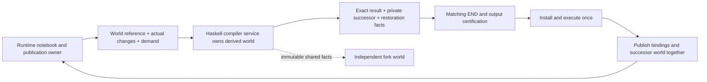

# Shared warm compiler: delivery plan

Status: active implementation campaign. Reviewed host, custody, worker and canonical
reload foundations are integrated; see [current status](STATUS.md). Exact6f9 joined
ten production/test/Haskell consumers,154 workflow cases, Rust2 and Haskell2 passed.
Actual Rooted queries executed2: source-domain/reexport/absence history passed;
the other case passed cold and initial hot queries before a fixture failure.
Genuine frontend/growing-history controls, required ordinary-cell/publication/recovery
migration and measured improvement remain unqualified. Paired inspect/prepareCell
contracts are accepted; new-profile protocol and exact publication-owner repairs
are actively implementing and compiling. No full Ready lifecycle or speedup is claimed.


This directory is the handoff for a Sol supervision tree. Read this file, the
[shared contracts](CONTRACTS.md), and the [supervisor assignment](supervisor/README.md)
first. The directory structure mirrors the area owners and their successive
worker assignments. It is a delivery plan, not a proposal to build an agent
orchestration framework.

Read [compiler-owned worlds](DEMAND-SERVICE.md) before further host/worker API
work. It changes the organizing boundary: Haskell owns derived compiler worlds;
Rust supplies primary notebook changes and publishes exact returned products.
Earlier references to host-issued roots describe authoritative selection facts,
not a requirement to maintain GHC's derived dependency world in Rust.

The [required Rust client migration](RUST-CLIENT-MIGRATION.md) makes that boundary
concrete: actors obtain a scoped compiler client from their published world and
query/prepare through it. Ordinary cells, successor publication and recovery are
required delivery, not a later optional cache extension. It supersedes any cold
constructor that merges all retained value support into current source selection.

The [overnight root instructions](OVERNIGHT.md) specify Sol-low coordination,
Sol medium/high implementation and review, optional Luna helpers, and the
morning escalation boundary.

## Outcome

Make ordinary notebook work pay for new source and changed dependencies, rather
than repeatedly rebuilding evidence about unchanged history. Preserve exact
implementation selection, issued dependencies, source ownership, cancellation,
and publication. Use a bounded shared pool of warm GHC workers; do not require a
resident process for every actor.

The campaign has two deliverables:

1. A reviewed, integrated production compiler service: immutable selected worlds,
   demand-specific queries, shared owned input rows, incremental notebook
   publication, bounded worker residency, and changed-reload retirement.
2. A measured frontend experiment that determines whether ordinary-module import
   processing can also reuse a checked environment safely. Promote that change
   only if its semantic and performance gates pass. Otherwise preserve its
   findings and deliver the first candidate without claiming the frontend cost
   has disappeared.

Tenfold improvement is the search target. It is not an acceptance result or an
estimate. Success requires measured structural work removal and a useful joined
candidate, with remaining time honestly attributed.

## Source and integration boundary

- Plan source: `70a92c65a02a591f76590daf4e5bfa3e6fcbf723`, branch
  `integration/harness-threshold-20261019` as inspected on 2026-10-19.
- Earlier research audited `0fd622bf592f8f015a3795d6e52f36a109ec2f12`.
  Source symbols in each assignment must be rechecked at the implementation base.
- The plan lives on `plan/shared-warm-compiler-20261019` in the isolated checkout
  `/srv/swarm/checkouts/tidepool-shared-warm-plan-20261019`.
- Implementation branches from the **latest coordinated release tip at kickoff**,
  not this research pin. The performance-fork root coordinates this campaign;
  the external release/main/live-host owner remains unconfirmed. The campaign
  supervisor records the fresh remote and
  local release OIDs and receiving owner; it must not change the parent's active
  checkout or race its pushes. Use a campaign branch and isolated area/leaf
  worktrees. Fold any required peer correctness repair before baselining.
- The retained-implementation selection repair is already in this plan base.
  Preserve it through rebases. Its imported stronger direct Persona passed1/1,
  with compiler cleanup not_observed and diagnostics incomplete; it is not a
  matched frozen baseline for current campaign qualification.

## Supervision tree

```text
Sol-low root / user-managed continuation    OVERNIGHT.md
└── Sol-high campaign supervisor            supervisor/README.md
    ├── Sol host-input supervisor           host-inputs/
    │   ├── selected root and mutation ownership
    │   ├── dependency-sensitive admission
    │   └── joined publication and obsolete-path removal
    ├── Sol input-custody supervisor        owned-inputs/
    │   ├── shared interface rows
    │   ├── package universe ownership
    │   └── backing lifetime and transport integration
    ├── Sol compiler-worker supervisor      warm-workers/
    │   ├── exact worker realizations
    │   ├── bounded pool and measured affinity
    │   └── checked import-context experiment
    ├── Sol reload supervisor               reload/
    │   ├── retirement contract and dependency stamps
    │   ├── generation fence and confirmed drain
    │   └── public API and joined acceptance
    └── Sol qualification lead              qualification/
        ├── baseline and independent semantic oracles
        ├── incremental joined histories
        └── performance, frozen bundle and release handoff
```

Each area has a feature branch. The reviewed assignment authorizes bounded
implementation within its contract; new or changed shared decisions go to the
supervisor before implementation. Exact candidates receive independent review
and repair. The area supervisor folds the accepted commit before starting a
dependent wave. The campaign supervisor folds compatible area checkpoints into
one integration branch throughout the campaign. No final pile of unrelated
unmerged branches. [Supervision](SUPERVISION.md) defines slots, ownership,
communication, restart records and exact-candidate review.

The actors can message each other. Messages settle technical questions; Git
commits and the recorded contract revision define what was actually integrated.

## Shared dataflow



Custody can contain more than the selected root. A compiler namespace can select
one implementation while exact issued dependency edges retain older bodies.
Those edges are not reconstructed from custody or a latest-module map. Worker
realization is reusable compiler data, not runtime permission or publication
authority.

## Checkpoints and dependencies

| Checkpoint | Required outputs | Parallel work enabled | Fold requirement |
| --- | --- | --- | --- |
| G0: agree and observe | Current source baseline; shared contracts; selection regression oracle; current phase/counter coverage | All area first waves, with coordinated shared-file edits | Compile any shared scaffolding and exercise a small production history immediately |
| G1: establish service ownership | Runtime facts versus compiler-derived state inventory; exact world/restoration contract; owned rows and package-source decision | First actual inspection/check service path; independent reload work | Independent selection, source lifetime and production consumer review |
| G2: prove demand-based operation | Held compiler world; actual lookup/check caller; no host export before hit; cold restore | Cell and publication migration; bounded retention | Exact module/visibility semantics, no hidden full preparation or worker rebuilding |
| G3: migrate cells and publication | Whole-cell checking/executable demand; paired successor publication; fork/reload/recovery; old route deletion | Frontend experiment and qualified affinity comparison | No missed mutation route; END/cancellation, stale writer and divergent-world controls |
| G4: decide and qualify | Import-context decision; joined source; updated engine map; matched baseline/candidate evidence | Release owner integration and subsequent exploratory runs | Frozen bundle and all claimed workloads qualify at the exact delivered commit |

These are dependency gates, not global barriers. For example, input-row work and
reload ownership work can proceed while host delta work is reviewed. An area
must name the exact prerequisite commit it consumes. A supervisor does not fill
an idle slot with unrelated speculative work while a known critical defect waits.

## Scope decisions

- Keep the existing compiler/toolchain/runtime owners. Reuse current persistent
  maps, immutable evidence, transactions, lifecycle and test infrastructure.
- Do not introduce a general query engine or adopt Shake/Salsa/DICE in this
  campaign. Apply dependency-aware reuse to concrete products first.
- Changed explicit reload retires the whole old notebook generation, using the
  existing fresh replacement notebook. Default refusal lists blocking dependent
  non-LLM resources; explicit force permits their scoped shutdown. Independent
  LLM actors keep their own worlds. See the precise transitional continuation
  rule in [CONTRACTS.md](CONTRACTS.md).
- Ordinary append/shadow, independently retained forks, and cold recovery still
  require exact historical dependency semantics. Reload retirement does not
  license flattening those graphs.
- Do not add server swap, enlarge daemon counts, change shared services, or make
  optional warm caches durable authorities. Resource-policy changes require
  separate measurements and infrastructure coordination.
- Backcompat is not a goal for bad internal APIs. Version wire/durable changes
  deliberately; retain a clear old-format refusal or existing migration path,
  never silently reinterpret old identities.

## Delivery evidence

The [qualification subtree](qualification/README.md) specifies the counted tests,
independent oracles and measurements. In every tranche require:

- Successful optional-root replacement and genuine required-edge conflict
  refusal, using production issuers and the shared-workspace construction path.
- Exact source selection plus physical custody survives failure, fork and touched
  recovery paths. No accepted-uncertain compiler or external effect replay.
- A complete map of state mutations and source-bearing callbacks; the new safe
  entry point is the only route used by production callers.
- Work counters for unchanged history, new facts and affected dependencies;
  unique bytes and retained backing allocations; startup and hot/cold execution
  timings separated. A faster failed test is not a performance acceptance.
- Review and focused tests on each exact candidate, then joined tests on the
  merged candidate. Compile affected test consumers early.

The final report names what shipped, what was deliberately not promoted, what
the exact bundle passed, observed speedups and remaining costs. It must include
the [compiler work map](../../docs/compiler-work-map.md) update and all remaining
branch dispositions.

## Start and resume

1. Read [STATUS.md](STATUS.md) and [EVIDENCE.md](EVIDENCE.md).
2. Read the [campaign supervisor assignment](supervisor/README.md).
3. Confirm the agreed implementation base and current parent delivery state.
4. Launch only dependency-ready planning/implementation leaves, with the stated
   global slot and build limits.
5. Fold each reviewed checkpoint upward; update status before a restart or handoff.

This plan does not itself authorize launching implementation during a
documentation/research-only turn. It is ready to hand to the Sol supervisor when
the user asks to execute it.
