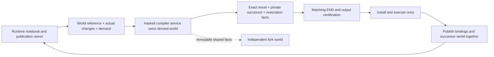

# Shared warm compiler: delivery plan

> **Current entry point:** [completion/plan.md](completion/plan.md), with
> [locked contracts](completion/contracts.md) and its linked worker subplans.
> The reviewed base is `6f7ae09b3b` on the published
> `integration/compiler-query-warm-final` branch; code tip `92fa518105`.
> The completion plan requires the sole compiler-service cell route, deletion
> of finite admission and fixture authority, and an early qualified Persona run
> before the final mandatory campaign gates. The material below is historical;
> its old worker ownership, pause instructions and readiness claims do not govern
> the next wave. [Join evidence](mid-plan-notes/MILESTONE.md) and
> [old parcels](mid-plan-notes/OPEN-PARCELS.md) remain available as source material.

Current user boundary: all existing workers reached **READY_FOR_BACKEND_HANDOFF**.
Read [TAKEOVER.md](TAKEOVER.md) and [STATUS.md](STATUS.md) before resuming.
The feature remains incomplete; this explicit natural-boundary backend transition
supersedes the earlier overnight drain-to-completion instruction for this session.
No new implementation wave starts until the new backend takes ownership.


Status: active, incomplete implementation campaign; see [current status](STATUS.md) and [resumable handoff](HANDOFF.md).
Integrated bedfe31 passed eight production/test consumers,154 workflow checks and43
counted tests, including actual service-backed public-module query histories and
reviewed Reload publisher/opaque-root/reply ownership. The critical next outcome is
a genuine nonempty three-root/import ordinary cell, private successor, atomic
bindings/world publication and second-cell use with exact world-owned dependency
reuse. Query/foundation acceptance does not establish ordinary-cell migration,
frozen qualification, full force/drain or a measured speedup.

This directory is the handoff for a Sol supervision tree. Read this file, the
[shared contracts](CONTRACTS.md), and the [supervisor assignment](supervisor/README.md)
first. The directory structure mirrors the area owners and their successive
worker assignments. It is a delivery plan, not a proposal to build an agent
orchestration framework.

Read [compiler-owned worlds](DEMAND-SERVICE.md) before further host/worker API
work. It changes the organizing boundary: Haskell owns derived compiler worlds;
Rust supplies primary notebook changes and publishes exact returned products.
Earlier references to host-issued roots describe authoritative selection facts,
not a requirement to maintain GHC's derived dependency world in Rust.

The [required Rust client migration](RUST-CLIENT-MIGRATION.md) makes that boundary
concrete: actors obtain a scoped compiler client from their published world and
query/prepare through it. Ordinary cells, successor publication and recovery are
required delivery, not a later optional cache extension. It supersedes any cold
constructor that merges all retained value support into current source selection.

The [overnight root instructions](OVERNIGHT.md) specify Sol-low coordination,
Sol medium/high implementation and review, optional Luna helpers, and the
morning escalation boundary.

## Outcome

Make ordinary notebook work pay for new source and changed dependencies, rather
than repeatedly rebuilding evidence about unchanged history. Preserve exact
implementation selection, issued dependencies, source ownership, cancellation,
and publication. Use a bounded shared pool of warm GHC workers; do not require a
resident process for every actor.

The campaign has two deliverables:

1. A reviewed, integrated production compiler service: immutable selected worlds,
   demand-specific queries, shared owned input rows, incremental notebook
   publication, reuse of eligible checked dependencies for ordinary cells,
   bounded worker residency, and changed-reload retirement.
2. A measured, conditional deeper frontend experiment: determine whether the
   remaining ordinary-module import/reader processing can reuse a checked import
   environment safely. This is arm C in the worker plan. Arm B's exact selected
   home/dependency reuse belongs to the first deliverable, not a late optional
   experiment. Neither an HPT hit nor a smaller request establishes that reuse.

Tenfold improvement is the search target. It is not an acceptance result or an
estimate. Success requires measured structural work removal and a useful joined
candidate, with remaining time honestly attributed.

## Source and integration boundary

- Plan source: `70a92c65a02a591f76590daf4e5bfa3e6fcbf723`, branch
  `integration/harness-threshold-20261019` as inspected on 2026-10-19.
- Earlier research audited `0fd622bf592f8f015a3795d6e52f36a109ec2f12`.
  Source symbols in each assignment must be rechecked at the implementation base.
- The plan lives on `plan/shared-warm-compiler-20261019` in the isolated checkout
  `/srv/swarm/checkouts/tidepool-shared-warm-plan-20261019`.
- Implementation branches from the **latest coordinated release tip at kickoff**,
  not this research pin. The performance-fork root coordinates this campaign;
  the external release/main/live-host owner remains unconfirmed. The campaign
  supervisor records the fresh remote and
  local release OIDs and receiving owner; it must not change the parent's active
  checkout or race its pushes. Use a campaign branch and isolated area/leaf
  worktrees. Fold any required peer correctness repair before baselining.
- The retained-implementation selection repair is already in this plan base.
  Preserve it through rebases. Its imported stronger direct Persona passed1/1,
  with compiler cleanup not_observed and diagnostics incomplete; it is not a
  matched frozen baseline for current campaign qualification.

## Supervision tree

```text
Sol-low root / user-managed continuation    OVERNIGHT.md
└── Sol-high campaign supervisor            supervisor/README.md
    ├── Sol host-input supervisor           host-inputs/
    │   ├── selected root and mutation ownership
    │   ├── dependency-sensitive admission
    │   └── joined publication and obsolete-path removal
    ├── Sol input-custody supervisor        owned-inputs/
    │   ├── shared interface rows
    │   ├── package universe ownership
    │   └── backing lifetime and transport integration
    ├── Sol compiler-worker supervisor      warm-workers/
    │   ├── exact worker realizations
    │   ├── bounded pool and measured affinity
    │   └── checked import-context experiment
    ├── Sol reload supervisor               reload/
    │   ├── retirement contract and dependency stamps
    │   ├── generation fence and confirmed drain
    │   └── public API and joined acceptance
    └── Sol qualification lead              qualification/
        ├── baseline and independent semantic oracles
        ├── incremental joined histories
        └── performance, frozen bundle and release handoff
```

Each area has a feature branch. The reviewed assignment authorizes bounded
implementation within its contract; new or changed shared decisions go to the
supervisor before implementation. Exact candidates receive independent review
and repair. The area supervisor folds the accepted commit before starting a
dependent wave. The campaign supervisor folds compatible area checkpoints into
one integration branch throughout the campaign. No final pile of unrelated
unmerged branches. [Supervision](SUPERVISION.md) defines slots, ownership,
communication, restart records and exact-candidate review.

The actors can message each other. Messages settle technical questions; Git
commits and the recorded contract revision define what was actually integrated.

## Shared dataflow



Custody can contain more than the selected root. A compiler namespace can select
one implementation while exact issued dependency edges retain older bodies.
Those edges are not reconstructed from custody or a latest-module map. Worker
realization is reusable compiler data, not runtime permission or publication
authority.

## Checkpoints and dependencies

| Checkpoint | Required outputs | Parallel work enabled | Fold requirement |
| --- | --- | --- | --- |
| G0: agree and observe | Current source baseline; shared contracts; selection regression oracle; current phase/counter coverage | All area first waves, with coordinated shared-file edits | Compile any shared scaffolding and exercise a small production history immediately |
| G1: establish service ownership | Runtime facts versus compiler-derived state inventory; exact world/restoration contract; owned rows and package-source decision | First actual inspection/check service path; independent reload work | Independent selection, source lifetime and production consumer review |
| G2: prove demand-based operation | Held compiler world; actual lookup/check caller; no host export before hit; cold restore | Cell and publication migration; bounded retention | Exact module/visibility semantics, no hidden full preparation or worker rebuilding |
| G3: ordinary cells reuse dependencies | Real nonempty bind then later use; retained eligible compiler answers; exact per-item successors and atomic publication; early work/timing comparison | Remaining mutation/lifecycle coverage, deletion and conditional arm C | Actual values and world transitions; no hidden whole-world rebuild; fresh authority and strict dependency refusals |
| G4: complete and qualify | Fork/reload/recovery and removal coverage; scoped retirement; deeper import-context decision; exact packaged histories and paired measurements | Release owner integration and subsequent exploratory runs | Frozen bundle and all claimed workloads qualify at the exact delivered commit |

These are dependency gates, not global barriers. For example, input-row work and
reload ownership work can proceed while host delta work is reviewed. An area
must name the exact prerequisite commit it consumes. A supervisor does not fill
an idle slot with unrelated speculative work while a known critical defect waits.

### Next complete workflow

First join a production actor that captures its actual source/spec/effects,
uses a real imported module, publishes a binding, and uses that binding in the
next distinct cell. Observe W0 -> W1 -> W2, actual returned values, fresh target
checking, reused unchanged dependencies, and actual publication cost. Start
with the small `x <- pure (7 :: Int)` / `y <- pure (x + 1)` binding control, then
the same path with a declared home dependency and the real scaffold. The simple
integer control alone does not measure the expensive import workload.

The required producer/consumer join has four concrete owners:

| Work | Owner | Needed before this workflow passes |
| --- | --- | --- |
| Matched nonempty world receiver and binding activation | Warm protocol owner | Context, acquired primary associations and occurrence bindings agree; current compiler/profile boots with the actual declared dependencies |
| Prepare and output certification | Warm, with existing certifier review | Actual outputs and demanded input evidence, not reconstruction of a whole ExactCompilationRequest or a second certificate issuer |
| Private successor finalization and runtime publication | Host | Exact successful item facts and actual runtime changes; atomic bindings/world association through the existing owner |
| Reusable compiler dependencies | Warm | World-owned selected HPT and eligible completed answers with their exact validity and backing; fresh per-operation mutable checking state |

Capture successful target evidence before the reusable module cache removes the
target. A successor may share unchanged facts and backing, but must not retain a
predecessor world chain or borrow scratch that predecessor eviction will delete.
The two-root bootstrap branch cannot substitute for the accepted three-root
nonempty actor input contract. The matched codec/profile work is a real
prerequisite; additional general codec or cache machinery is not.

For the first join, adoption requires the exact published world base. Existing
semantic rebasing must not merge unrelated concurrent bindings while installing
a successor that omits them. Refuse a stale semantic base, retain the current
world and any prior committed prefix, and report completed effects without
replay. Storage-only restaging may retain the same semantic base. Service-backed
merge/recertification is a named subsequent concurrency obligation, not a
reason to accept mismatched bindings/worlds or rebuild the entire universe.

Do not wait for all query retention/eviction cases or every unrelated fixture
repair to start this join. Known defects in the facts, authority or publication
it actually consumes remain blockers. Retain independent work on those repairs.
Use an existing idle worker for a bounded missing contract/review before adding
headcount; the current bottleneck is joined implementation and feedback.

Measure this workflow before completing the full matrix or undertaking arm C.
Vary unrelated retained history separately from visible import scope, then one
changed dependency. Include an instance-only change and an equal-interface,
different-original refusal. Use the existing production constructor and counted
runner; do not hand-assemble a privileged world or an approximate effects row.

An intermediate usable candidate may explicitly refuse `force: true` while
scoped forced retirement is unfinished. It must still fence stale source work,
keep a visible-but-unacknowledged generation nonoperational, preserve exact birth
provenance, and safely refuse blocked default reload. This is partial delivery,
not full campaign completion. Full force/drain and the remaining lifecycle
matrix stay authorized and tracked; optional arm C may conclude with a no-go.

## Scope decisions

- Keep the existing compiler/toolchain/runtime owners. Reuse current persistent
  maps, immutable evidence, transactions, lifecycle and test infrastructure.
- Do not introduce a general query engine or adopt Shake/Salsa/DICE in this
  campaign. Apply dependency-aware reuse to concrete products first.
- Changed explicit reload retires the whole old notebook generation, using the
  existing fresh replacement notebook. Default refusal lists blocking dependent
  non-LLM resources; explicit force permits their scoped shutdown. Independent
  LLM actors keep their own worlds. See the precise transitional continuation
  rule in [CONTRACTS.md](CONTRACTS.md).
- Ordinary append/shadow, independently retained forks, and cold recovery still
  require exact historical dependency semantics. Reload retirement does not
  license flattening those graphs.
- Do not add server swap, enlarge daemon counts, change shared services, or make
  optional warm caches durable authorities. Resource-policy changes require
  separate measurements and infrastructure coordination.
- Backcompat is not a goal for bad internal APIs. Version wire/durable changes
  deliberately; retain a clear old-format refusal or existing migration path,
  never silently reinterpret old identities.

## Delivery evidence

The [qualification subtree](qualification/README.md) specifies the counted tests,
independent oracles and measurements. In every tranche require:

- Successful optional-root replacement and genuine required-edge conflict
  refusal, using production issuers and the shared-workspace construction path.
- Exact source selection plus physical custody survives failure, fork and touched
  recovery paths. No accepted-uncertain compiler or external effect replay.
- A complete map of state mutations and source-bearing callbacks; the new safe
  entry point is the only route used by production callers.
- Work counters for unchanged history, new facts and affected dependencies;
  unique bytes and retained backing allocations; startup and hot/cold execution
  timings separated. A faster failed test is not a performance acceptance.
- Review and focused tests on each exact candidate, then joined tests on the
  merged candidate. Compile affected test consumers early.

The final report names what shipped, what was deliberately not promoted, what
the exact bundle passed, observed speedups and remaining costs. It must include
the [compiler work map](../../docs/compiler-work-map.md) update and all remaining
branch dispositions.

## Known follow-ups

### `prepare_independent_effect` dispatch frame (M6a, 2026-10-19)

`ResidentKernelBehavior::prepare_independent_effect`
(`exomonad/actor/src/resident_actor.rs:6151`) builds every branch's
`Box::pin(async move { .. })` future in one match frame. Under `fast-dev`,
which compiles `exomonad-actor` at `-Copt-level=0`, each construction
temporary keeps its own stack slot: the function's 30 `exchange_malloc` sites
total 269,864 B and the frame measures 322,016 B (gdb disassembly of the
`hosted-acceptance` crash binary). The same poll chain holds
`execute_workbench` (~295,816 B) and `settle_fragment_effects` (~219,832 B),
so the 2 MiB default thread stack overflows; a 4 MiB `RUST_MIN_STACK` run
passes and the M6a evidence run uses an 8 MiB stack on that test-only thread
(no production thread is changed).

Measured at the shipped profile: `production` is `-Copt-level=3` for every
package (`build/native_profile.bzl:18-19`), and the same scenario passes at
the default 2 MiB stack there. In that binary `prepare_independent_effect`
measures 36,264 B (gdb disassembly, artifact sha256 `395f6948…`), an 8.9x
reduction from the opt-0 frame, so the overflow is a fast-dev/debug codegen
artifact rather than a production stack requirement. The bundle profile is
invocation configuration (`build/package/native_catalog.bzl:177`); a
fast-dev-assembled bundle would still carry the opt-0 frame.
The measurement uses the production-profile host test binary; the frozen
release bundle itself was not rebuilt or measured in this parcel.

Bounded follow-up: construct each heavy branch's future in an out-of-line
`#[inline(never)]` helper (or split the dispatch) so the peak frame is the
largest branch rather than the sum. Do not refactor the 750-line match
incidentally in an unrelated parcel; merge-conflict risk is high while the
second-cell tranche is in flight.

## Start and resume

1. Read [STATUS.md](STATUS.md) and [EVIDENCE.md](EVIDENCE.md).
2. Read the [campaign supervisor assignment](supervisor/README.md).
3. Confirm the agreed implementation base and current parent delivery state.
4. Launch only dependency-ready planning/implementation leaves, with the stated
   global slot and build limits.
5. Fold each reviewed checkpoint upward; update status before a restart or handoff.

This plan does not itself authorize launching implementation during a
documentation/research-only turn. It is ready to hand to the Sol supervisor when
the user asks to execute it.
